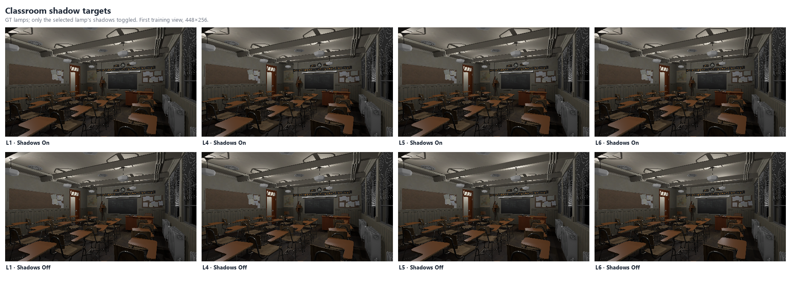
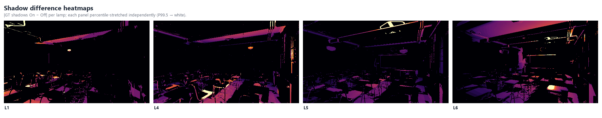
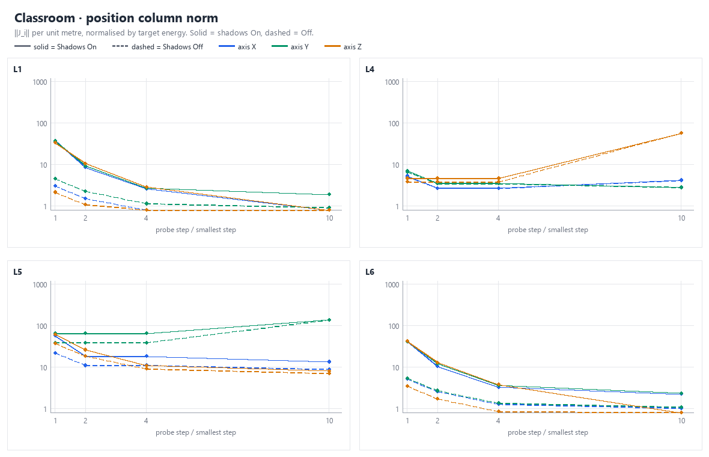
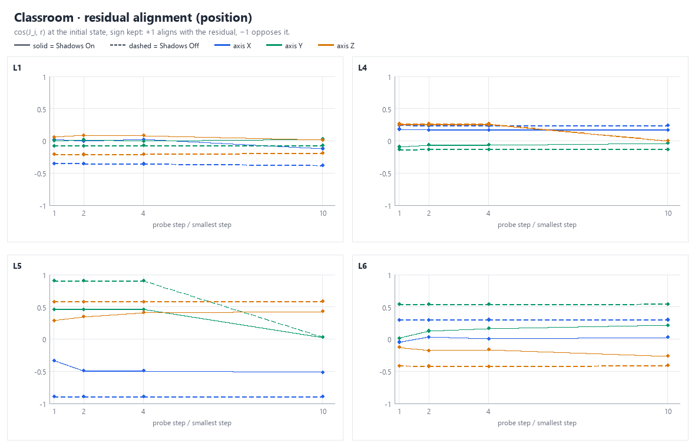
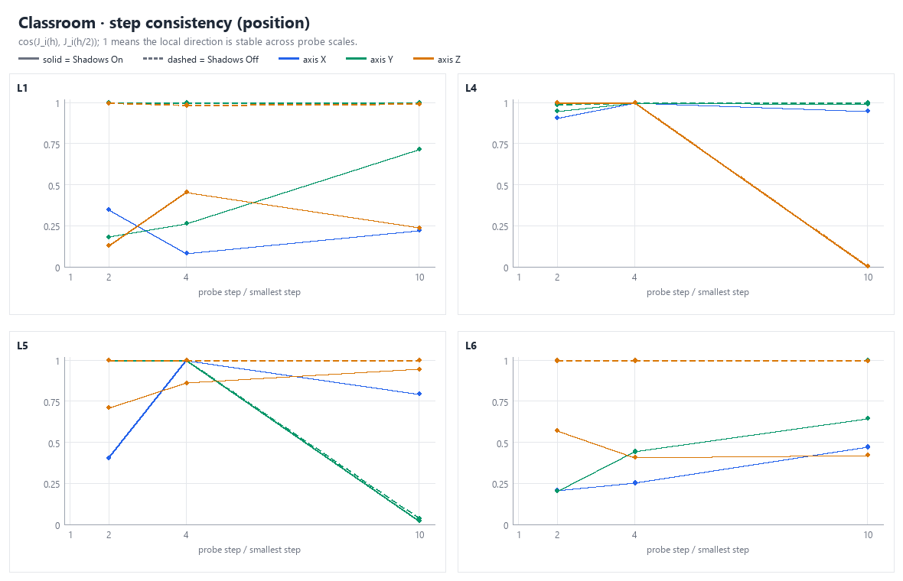
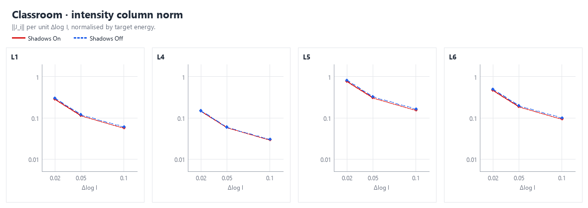
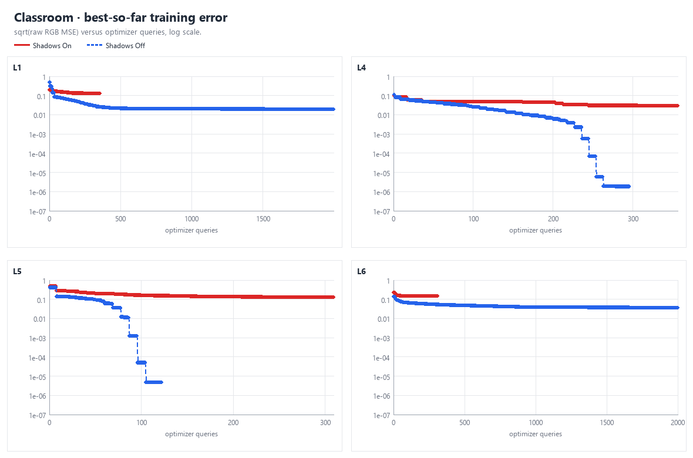
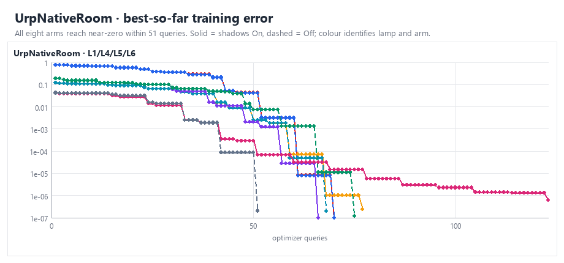

# Unity Classroom 黑盒灯光局部敏感性与阴影诊断 · E17

本轮在 Classroom 与 UrpNativeRoom 两个场景上执行 E17：直接使用 Unity 原生线性 HDR RGB 拍摄，不引入 Irradiance、代理模型或外部渲染器。Classroom 是复杂、真实失败的场景；UrpNativeRoom 是七灯、规则几何的简单对照。

固定条件为 Unity 2022.3.62f3c1、URP 14.0.12、Direct3D11、Linear、3 个训练视角 `448×256`、5 个检查视角 `896×512`（前 3 个与训练同视角，后 2 个为留出视角）、实时硬阴影、固定曝光与材质。每次只优化一盏灯的 `XYZ + log(I)`，其余六盏固定在 GT；预算 2000 次训练查询，每次查询包含 3 次相机拍摄。主实验使用 seed 131 与 E13d 保存的近起点；重复拍摄噪声为 0，像素变化阈值为 `1e-7`。

**结论摘要**

- Classroom 关闭所选灯自身的阴影后，L1、L6 的位置 Jacobian 方向一致性从 `0.293 / 0.404` 升到 `0.997 / 0.999`；L5 从 `0.750` 升到 `0.893`；L4 仅从 `0.867` 升到 `0.887`，且 L4 在阴影开启时本来就成功。
- 阴影是真实失败机制之一，但不是充分解释。补跑的远起点中，L5 关闭阴影后 Jacobian 仍满秩、方向一致性接近 `1`，却仍停在距离 GT 约 `84–90 cm` 的位置；同一 seed 131 的近起点则可精确恢复。
- UrpNativeRoom 的 8 个 On/Off 臂全部精确恢复；其阴影差能量比 Classroom 小 `10–152` 倍，局部响应几乎不随阴影开关变化。该场景只能证明同一条原生 RGB 路径在简单场景可解，不能用于诊断 Classroom 的失败。
- Jacobian 满秩不是成功的充分条件。L1 阴影开启时秩为 4，但初始方向一致性仅 `0.293`、残差对齐仅 `0.039`，优化器在 355 次查询后以 `no_decreasing_step` 停止。

## E17-A：阴影消融

只切换当前待优化灯的 `LightShadows`，其余六盏灯、材质、相机和灯具参数不变；Shadows On/Off 各自捕获独立的 GT Target。下图是四盏灯在 GT 状态下的 On/Off 目标与阴影差热图。





阴影统计定义：`shadowRms` 为 On/Off 图像差的 RMS 除以 On 图像能量；`moved` 为起点处阴影差能量除以 GT 处阴影差能量；`affected` 为 On/Off 差异超过噪声阈值的像素比例；`overlapOn` 为该区域与“起点参数误差区域”的重合比例。

| 场景 | 灯 | shadowRms | moved | affected | overlapOn |
|---|---|---:|---:|---:|---:|
| Classroom | L1 | 0.5968 | 0.10× | 11.77% | 31.23% |
| Classroom | L4 | 0.0802 | 0.66× | 12.59% | 43.89% |
| Classroom | L5 | 0.1861 | 0.31× | 10.40% | 61.67% |
| Classroom | L6 | 0.1119 | 0.49× | 12.32% | 59.40% |
| UrpNativeRoom | L1 | 0.00869 | 1.10× | 8.56% | 15.84% |
| UrpNativeRoom | L4 | 0.00154 | 2.57× | 5.37% | 37.58% |
| UrpNativeRoom | L5 | 0.00122 | 1.76× | 5.12% | 72.06% |
| UrpNativeRoom | L6 | 0.01063 | 0.04× | 12.41% | 29.65% |

Classroom 的 L1 阴影差达到目标能量的 60%，L5 为 19%，L6 为 11%，L4 为 8%。Room 的对应值分别为 0.9%、0.15%、0.12%、1.1%，比 Classroom 小约 `10–152` 倍。

### 优化结果

`同视角复拍` 是 3 个训练视角在 `896×512` 的 NRMSE；`留出` 是另外 2 个视角的 NRMSE。位置与强度误差相对 GT 计算。`接受/拒绝` 为 LM 实际接受与拒绝的候选步数。

| 灯 | 阴影 | 训练 NRMSE 初→末 | 同视角复拍 | 留出 | 位置误差 | 强度误差 | 查询 | 接受/拒绝 | 停止原因 |
|---|---|---:|---:|---:|---:|---:|---:|---|---|
| L1 | On | 20.0% → 13.3% | 13.9% | 2.9% | 6.90 cm | 6.1% | 355 | 19 / 77 | no_decreasing_step |
| L1 | Off | 48.6% → 2.0% | 28.6% | 0.5% | 3.35 cm | 3.6% | 1,996 | 218 / 27 | budget |
| L4 | On | 9.6% → 3.0% | 4.0% | 2.8% | 1.11 cm | 3.1% | 356 | 22 / 87 | no_decreasing_step |
| L4 | Off | 11.6% → 0.0% | 0.0% | 0.0% | 0.0003 cm | 0.0004% | 295 | 29 / 19 | no_decreasing_step |
| L5 | On | 49.4% → 13.3% | 13.2% | 39.9% | 4.23 cm | 4.4% | 309 | 16 / 63 | no_decreasing_step |
| L5 | Off | 41.5% → 0.0% | 0.0% | 0.0% | 0.0001 cm | 0.00004% | 122 | 11 / 9 | no_decreasing_step |
| L6 | On | 22.8% → 14.7% | 14.6% | 2.5% | 22.87 cm | 9.8% | 310 | 14 / 89 | no_decreasing_step |
| L6 | Off | 13.7% → 3.7% | 19.7% | 0.24% | 4.49 cm | 1.4% | 2,000 | 222 / 0 | budget |

以 `位置 ≤ 5 cm 且强度 ≤ 5%` 计，L1 On、L6 On 失败；L4 On、L1 Off、L4 Off、L5 On、L5 Off、L6 Off 达到参数门槛。图像域并不完全一致：

- L4 On 同时满足参数门槛和低复拍误差（4.0% / 2.8%），是阴影开启时唯一稳定的成功臂。
- L5 On 的位置与强度刚好落在门槛内，但留出 NRMSE 为 39.9%，图像域没有恢复。
- L1 Off 的参数达标，但同视角高分辨率复拍仍有 28.6%；L6 Off 的复拍为 19.7%，位置误差 4.49 cm，接近 5 cm 上限。
- L5 Off 是唯一在训练、同视角复拍和留出三处都接近零的臂。

## E17-B：多尺度位置与强度探测

位置步长取 `0.5 / 1 / 2 / 5 cm`；方向一致性比较 `J(h)` 与 `J(h/2)`，取 `1 / 2 / 5 cm` 三档均值；`0.5 cm` 档是序列首项，没有更小步长作参照，不计入均值。强度步长取 `Δlog I = 0.02 / 0.05 / 0.10`。









初始状态（E13d 近起点）的位置探测统计：

| 灯 | 一致性 On | 一致性 Off | 平均绝对残差对齐 On | 对齐 Off | 列范数 On | 列范数 Off |
|---|---:|---:|---:|---:|---:|---:|
| L1 | 0.293 | 0.997 | 0.039 | 0.212 | 5.68 | 1.11 |
| L4 | 0.867 | 0.887 | 0.142 | 0.190 | 4.41 | 3.82 |
| L5 | 0.750 | 0.893 | 0.394 | 0.721 | 41.63 | 20.29 |
| L6 | 0.404 | 0.999 | 0.114 | 0.420 | 7.14 | 1.54 |

Room 的初始一致性在 On/Off 下为 `0.944–1.000`，列范数和残差对齐几乎不随阴影开关变化。

观察：

- 阴影开启时，L1 与 L6 的方向一致性最低，且开启/关闭的差距最大；L4 的差距最小，并在 On 状态下成功。
- L1、L5、L6 的 On 列范数分别为 Off 的 `5.1× / 2.1× / 4.6×`；L4 仅为 `1.2×`。阴影边缘给位置列增加了明显的高频分量，而强度列的范数和一致性在 On/Off 下几乎不变。
- 残差对齐不能单独解释失败：L5 On 的初始对齐为 `0.394`，高于 L4 的 `0.142`，但 L5 On 未能在图像域恢复；L1 On 的 `0.039` 接近正交，优化器几乎没有可下降方向。
- 关闭阴影后，L5 的列范数仍为 `20.29`，方向一致性 `0.893`，对齐 `0.721`，并在 122 次查询内精确收敛。说明该近起点下阴影是主要障碍。

## E17-C：优化轨迹与停止行为



阴影开启的臂普遍在 309–356 次查询后停止，拒绝步 63–89 次；L1 On 与 L6 On 还分别出现 9 次和 2 次探测阻断。关闭阴影后：

- L4 Off 在 295 次查询内收敛，位置误差 `0.0003 cm`。
- L5 Off 在 122 次查询内收敛，位置误差 `0.0001 cm`。
- L1 Off 与 L6 Off 用满 2000 次预算，最终训练 NRMSE 为 2.0% 与 3.7%；两者仍持续缓慢下降，没有提前触发 `no_decreasing_step`。

Gram 矩阵在所有试次中秩均为 4。Classroom 初始条件数：L1 On `89.5`、L4 On `53.5`、L5 On `49.2`、L6 On `64.2`；Off 分别为 `15.4 / 69.7 / 104.2 / 7.5`。L1 On 的条件数在停止时降到 `42.5`，L6 On 降到 `21.6`，但两者仍失败。因此“满秩”与“条件数改善”都不足以保证 RGB 残差可下降。

轨迹上，On 臂的候选步大量被拒绝后停止；Off 臂中 L4/L5 快速收敛，L1/L6 继续消耗预算。停止原因不是预算耗尽，而是当前局部模型找不到可接受的下降步；L1 Off 与 L6 Off 则没有在预算内触发该停止。

## E17-D：补充种子与同 seed 远起点对照

E17-D 不在最初一轮的执行范围内。完成 E17-A/B/C 后补跑了 seed 157、181；由于这两组缺少所选四盏灯完整的 E13d 保存起点，程序按设计回退到 `generated_far`。另外补跑了 seed 131 的远起点对照（`-bbE17Start` 指向不存在目录，强制 `generated_far`）。这些补充组不是 E13d near-start 的复验，起点距离也未与近起点匹配；例如 seed 131 远起点下 L5 的初始 NRMSE 为 832.5%，而近起点为 49.4%。

| seed / 起点 | L1 On → Off | L4 On → Off | L5 On → Off | L6 On → Off | Off 达标数 |
|---|---:|---:|---:|---:|---:|
| 131 / E13d near | 13.3% → 2.0% | 3.0% → 0.0% | 13.3% → 0.0% | 14.7% → 3.7% | 4 / 4 |
| 131 / generated far | 19.6% → 0.0% | 12.1% → 16.2% | 30.7% → 34.4% | 14.8% → 0.0% | 2 / 4 |
| 157 / generated far | 26.5% → 52.9% | 8.1% → 0.0% | 30.4% → 35.0% | 9.4% → 0.0% | 2 / 4 |
| 181 / generated far | 19.0% → 1.7% | 7.6% → 0.0% | 28.7% → 33.1% | 14.8% → 0.0% | 2 / 4 |

位置误差（cm，On → Off）：

| seed / 起点 | L1 | L4 | L5 | L6 |
|---|---:|---:|---:|---:|
| 131 / E13d near | 6.90 → 3.35 | 1.11 → 0.0003 | 4.23 → 0.0001 | 22.87 → 4.49 |
| 131 / generated far | 19.09 → 0.0003 | 68.07 → 70.32 | 81.04 → 86.54 | 24.14 → 0.0005 |
| 157 / generated far | 78.10 → 93.66 | 24.50 → 0.0002 | 94.72 → 89.65 | 3.57 → 0.0002 |
| 181 / generated far | 22.97 → 3.51 | 20.92 → 0.0002 | 80.05 → 83.93 | 21.82 → 0.0001 |

补充组的事实：

- 远起点下关闭阴影使 L6 三组全部收敛；L4 在 157、181 收敛，但 131 远起点停在 70.32 cm；L1 与 L5 均未稳定改善。181 的 L1 Off 训练 NRMSE 为 1.7%、位置误差 3.51 cm，但强度误差 5.9%，仍未达到参数门槛。
- L5 Off 在 131 far、157、181 三组全部失败，最终位置误差为 `86.54 / 89.65 / 83.93 cm`；其中 157、181 的初始位置探测一致性为 `1.00`，Gram 秩为 4，条件数为 `4.34 / 4.31`（best 状态），残差对齐仅 `0.10 / 0.03`。这不是阴影边缘造成的局部方向不稳定，而是平滑但接近正交的局部模型与路径依赖。
- 同一 seed 131 下，L5 Off 从近起点精确收敛，从远起点停在 86.54 cm；起点所在盆地直接改变结果。
- L4 Off 在 157、181 的远起点精确收敛，131 远起点停在 70.32 cm；L4 On 在三个远起点的最终位置误差为 `68.07 / 24.50 / 20.92 cm`；阴影对 L4 的影响依赖起点位置。
- L6 Off 在三个远起点均收敛到 `0.0002 cm` 以内；157 的 L6 On 也达到 3.57 cm，其余两个远起点的 L6 On 失败。

## UrpNativeRoom 对照

场景为 `Assets/Scenes/UrpNativeRoom.unity`，七盏暖白 Point Light，规则房间与简化材质，使用 stock Forward。8 个 On/Off 臂全部达到 `near_zero_residual`。

| 灯 | 阴影 | 初始 NRMSE | 最终 NRMSE | 位置误差 | 强度误差 | 查询 |
|---|---|---:|---:|---:|---:|---:|
| L1 | On | 78.0% | < 1e-6 | < 1e-6 cm | 5.2e-9 | 70 |
| L1 | Off | 78.0% | < 1e-6 | < 1e-6 cm | 1.2e-8 | 70 |
| L4 | On | 12.1% | 2.4e-7 | 2.4e-5 cm | 6.8e-8 | 77 |
| L4 | Off | 12.1% | 2.0e-7 | 3.4e-5 cm | 7.9e-7 | 68 |
| L5 | On | 19.5% | < 1e-6 | < 1e-6 cm | 3.7e-8 | 66 |
| L5 | Off | 19.5% | 1.2e-7 | 2.4e-5 cm | 4.0e-9 | 75 |
| L6 | On | 4.2% | 6.2e-7 | 2.4e-4 cm | 2.1e-6 | 123 |
| L6 | Off | 4.3% | 2.1e-7 | 2.3e-4 cm | 5.5e-6 | 51 |



Room 的初始条件数为 `6.1–11.0`，初始方向一致性为 `0.944–1.000`；阴影开关对列范数和残差对齐几乎没有影响。所有臂在 51–123 次查询内结束，位置误差不超过 `2.4e-4 cm`。该场景的阴影差能量小、几何规则、可见性简单，没有复现 Classroom 的局部失败，因此不能用于区分 E17 中的阴影、路径或其他非线性来源。

## 事实性归纳

1. Classroom 中，灯具自身阴影会显著改变位置参数的局部 RGB 响应。L1、L6 的方向一致性在阴影关闭后接近 1，L5 明显改善，L4 改善很小；强度列在所有灯上都不受阴影开关影响。
2. 阴影不是唯一原因。远起点下 L5 关闭阴影后仍有满秩、低条件数、接近 1 的步长一致性，却停在 84–90 cm 外；同一 seed 的近起点可以精确恢复。这里的主要现象是路径依赖或平滑局部极小，而不是阴影边界不连续。
3. Jacobian 满秩、条件数有限、候选步存在，都不足以保证下降。L1 On 和 L6 On 在这些条件满足时仍以 `no_decreasing_step` 停止；L1 On 初始条件数为 89.5，高于成功的 L4 On（53.5）。
4. 参数门槛与图像门槛不一致。L5 On 的位置/强度在 5 cm/5% 内，但留出 NRMSE 为 39.9%；L1 Off 参数达标但同视角复拍为 28.6%；L6 Off 复拍为 19.7% 且位置误差接近上限。
5. UrpNativeRoom 的原生 RGB 路径在 8/8 个臂上精确收敛。它证明当前 Unity 捕获、有限差分、LM 链路本身可解七灯单灯恢复，但不能复现 Classroom 的失败结构。

## 产物与复现

报告目录中的文件：

- `trials.csv`、`trials-steps.csv`、`jacobians.csv`、`probes.csv`、`probes-summary.csv`、`shadow-metrics.csv`、`gram.csv`：主实验的 seed 131 与 Room 数据。
- `trials-supplement.csv`、`probes-supplement.csv`：seed 131 远起点、157、181 的补充数据。
- `summary-classroom.json`、`summary-room.json`、`scene-classroom.json`、`scene-room.json`：完整逐臂结果、GT、相机和场景配置。
- `queries.zip`：Classroom、Room 及三个补充组的逐次查询记录，成员名已区分场景与起点。
- `classroom-shadow-targets.png`、`classroom-shadow-diff.png`、`classroom-probe-*.png`、`classroom-lm-trajectory.png`、`room-lm-trajectory.png`：报告图表。

复现命令（Unity 2022.3.62f3c1，使用 GPU 批处理，不能加 `-nographics`）：

```text
Unity -batchmode -force-d3d11 -projectPath <Unity项目> -executeMethod LightingMvp.Editor.NativeRecoveryExperiment.BatchRun -bbCase e17-classroom -bbOutput <输出目录> -bbE17Start <E13d结果目录> -logFile <日志>
Unity -batchmode -force-d3d11 -projectPath <Unity项目> -executeMethod LightingMvp.Editor.NativeRecoveryExperiment.BatchRun -bbCase e17-room -bbOutput <输出目录> -logFile <日志>
Unity -batchmode -force-d3d11 -projectPath <Unity项目> -executeMethod LightingMvp.Editor.NativeRecoveryExperiment.BatchRun -bbCase e17-classroom -bbOutput <输出目录> -bbE17Start <不存在的目录> -logFile <日志>
```

`-bbE17Start` 缺失或不完整时，Classroom 按设计回退到 `generated_far`；`e17-room` 不使用保存起点。优化查询以 3 个训练视角计为 3 次拍摄；GT、重复性检查、探测和结束后复拍单独记账。
