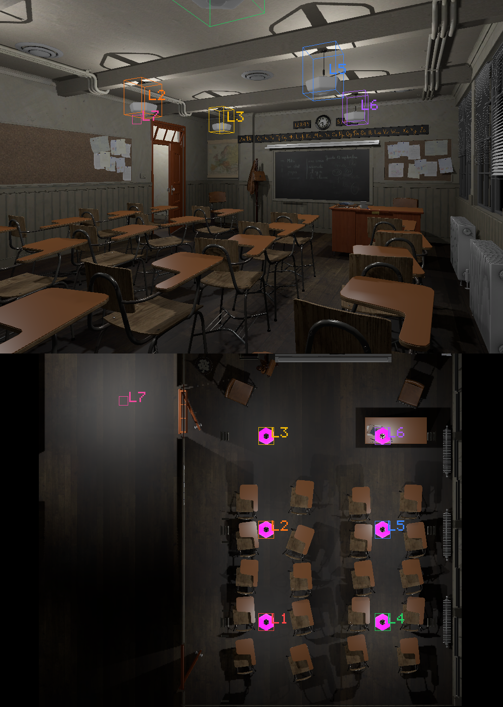
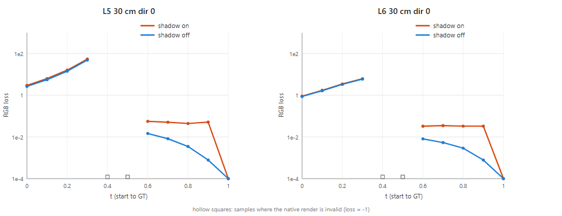

# Unity Classroom 黑盒灯光阴影鲁棒性 · E18

本轮在 Classroom 与 UrpNativeRoom 两个场景上执行 E18：优化目标始终是 Unity 原生 Linear HDR RGB，实时硬阴影全程保留，不引入神经网络、外部渲染器、Irradiance 代理或解析光照模型。实验要回答两件事：简单房间上的成功能否外推到 Classroom；硬阴影边界造成的梯度不连续是否是 Classroom 失败的主因。

**结论摘要**

- 灯具自遮挡只解释 L1。L1 只关闭灯具模型投影后，位置误差从 `26.25 cm` 降到 `2.96 cm`，而该自遮挡在图像上只占目标能量的 `3.67%`。L5、L6 排除灯具自身投影后仍分别停在 `63.36 cm`、`20.07 cm`，它们的障碍不在灯具网格。
- 关闭目标灯阴影后，L5、L6 都能精确恢复（`0 cm / 0%`）；开启后 L5 在全部 12 个受控起点中只成功 2 个，L6 只成功 3 个。硬阴影是真实且量级很大的失败机制。
- 阴影不是唯一原因。L5 在 Shadow Off 下 12 个起点也只成功 7 个，30 cm 与 60 cm 的若干方向仍停在 `46–90 cm`；oracle 路径非单调，起点到 GT 的直线插值存在不可行段。
- Classroom 的评测本身有两个混杂：优化视角 v2 的能量为 `8.31e7`，对灯光移动的响应约 `1e-6`，三个优化视角里实际只有两个提供梯度；同一参数下独立捕获的 448 与 896 目标在视角 0/1 上相差 `18%–49%`。
- UrpNativeRoom 在 10/30/60 cm、两个方向、Shadow On/Off 共 48 个臂上全部精确收敛，但它没有灯具网格、没有自遮挡、阴影差比 Classroom 小 `10–152` 倍，只能作为回归对照，不能作为复杂遮挡场景的证据。

## 1. 实验设置

| 项目 | 取值 |
|---|---|
| 场景 | Unity Classroom（7 盏 Point Light，优化其中 1 盏，其余 6 盏固定在 GT） |
| 引擎 | Unity 2022.3.62f3c1，URP 14.0.12，Direct3D11，Linear |
| 优化视角 | 3 个，`448×256` |
| 验证视角 | 5 个，`896×512`；视角 0–2 与优化同视角，视角 3–4 为留出视角 |
| 优化变量 | 单灯 `XYZ + log(I)`，共 4 维 |
| 查询预算 | 默认 800；单臂路径与收敛域实验为 350 |
| 渲染成本 | 1 次查询 = 3 次相机拍摄，`renders = 3 × queries` |
| 参数门槛 | 位置误差 ≤ 5 cm 且强度相对误差 ≤ 5% |

指标定义：

- `finalMeanViewNrmse`：`sqrt(Σ_v NRMSE_v² / 3)`，`NRMSE_v = ‖I_v − T_v‖ / ‖T_v‖`，逐视角各自归一化后按 3 个优化视角做均方根。
- `globalNrmse448`：3 个优化视角拼接后共用同一能量分母，`sqrt(Σ‖I−T‖² / Σ‖T‖² / 3)`。
- `nrmse896`：3 个优化视角在 `896×512` 下与独立捕获的 896 目标比较。
- `heldNrmse896`：留出视角 3–4 在 `896×512` 下的 NRMSE。

两种图像误差的分母不同，数值不可互换：优化视角的能量分别为 `21,072 / 15,289 / 83,143,707`，视角 2 占三者总能量的 `99.96%`。因此 `globalNrmse448` 实际上几乎只反映视角 2。E18 全部试次的重复拍摄差值为 0（`repeatDelta = 0`）。

复现命令：

```text
Unity -batchmode -force-d3d11 -projectPath Light -executeMethod LightingMvp.Editor.NativeRecoveryExperiment.BatchRun -bbCase e18-0 -bbOutput tmp/e18 -logFile tmp/e18-0.log
Unity -batchmode -force-d3d11 -projectPath Light -executeMethod LightingMvp.Editor.NativeRecoveryExperiment.BatchRun -bbCase e18-a -bbOutput tmp/e18 -logFile tmp/e18-a.log
Unity -batchmode -force-d3d11 -projectPath Light -executeMethod LightingMvp.Editor.NativeRecoveryExperiment.BatchRun -bbCase e18-b -bbOutput tmp/e18 -logFile tmp/e18-b.log
Unity -batchmode -force-d3d11 -projectPath Light -executeMethod LightingMvp.Editor.NativeRecoveryExperiment.BatchRun -bbCase e18-c -bbE18Budget 350 -bbOutput tmp/e18 -logFile tmp/e18-c.log
Unity -batchmode -force-d3d11 -projectPath Light -executeMethod LightingMvp.Editor.NativeRecoveryExperiment.BatchRun -bbCase e18-room-d -bbE18Budget 350 -bbOutput tmp/e18 -logFile tmp/e18-room-d.log
```

## 2. 灯具映射与自遮挡结构



六盏吊灯每盏由 3 个渲染器组成，合计 `5,144` 个三角面；L7 是走廊灯，没有灯具网格。灯具包围框覆盖灯体上下沿，Point Light 位于包围框内部。

| 灯 | 世界坐标 (m) | 灯具三角面 | 阴影差 RMS | 灯具自遮挡 RMS | 阴影影响像素 | 与灯具区域重叠 |
|---|---|---:|---:|---:|---:|---:|
| L1 | (-0.598, 2.314, -2.730) | 5,144 | 0.3921 | 0.0367 | 4.07% | 0.20% |
| L2 | (-0.598, 2.314, -0.668) | 5,144 | — | — | — | — |
| L3 | (-0.598, 2.314, 1.414) | 5,144 | — | — | — | — |
| L4 | (1.993, 2.314, -2.730) | 5,144 | 0.0938 | 0.0375 | 0.49% | 0.38% |
| L5 | (1.993, 2.314, -0.668) | 5,144 | 0.1895 | 0.0858 | 1.19% | 0 |
| L6 | (1.993, 2.314, 1.414) | 5,144 | 0.0775 | 0.0278 | 0.85% | 0 |
| L7 | (-3.772, 2.815, 2.197) | 0 | — | — | — | — |

`阴影差 RMS` 是目标灯 Shadow On/Off 图像差的 RMS 除以 On 目标能量；`灯具自遮挡 RMS` 是仅关闭该灯灯具模型投影后的图像差同口径归一化。L1 的灯具自遮挡只占目标能量 `3.67%`，但足以让优化结果从 `26.25 cm` 偏移回到 `2.96 cm`，说明失败与图像差幅度不成比例，而与局部导数结构有关。

## 3. E18-0：灯具投影与阴影消融

每个条件单独捕获 GT Target；`Full` 为全部投影体正常投射，`Fixture Off` 只关闭目标灯具模型的投影（灯具仍可见、仍接收阴影），`Shadow Off` 关闭目标灯阴影。所有臂从同一 4 维起点出发，预算 800。

| 灯 | 条件 | 三视角均方根 | 全局 448 | 留出 896 | 位置误差 | 强度误差 | 达标 |
|---|---|---:|---:|---:|---:|---:|---|
| L1 | Full | 11.01% | 0.30% | 2.73% | 26.25 cm | 5.98% | 否 |
| L1 | Fixture Off | 1.41% | 0.05% | 0.72% | 2.96 cm | 0.90% | 是 |
| L1 | Shadow Off | 0.52% | 0.02% | 0.22% | 1.19 cm | 4.47% | 是 |
| L4 | Full | 2.41% | 0.06% | 3.11% | 6.30 cm | 4.12% | 否 |
| L4 | Fixture Off | 1.19% | 0.03% | 13.23% | 4.06 cm | 3.19% | 是 |
| L4 | Shadow Off | 0.00% | 0.00% | 0.00% | 0.00 cm | 0.00% | 是 |
| L5 | Full | 16.17% | 0.43% | 51.50% | 67.15 cm | 58.17% | 否 |
| L5 | Fixture Off | 18.34% | 0.50% | 51.64% | 63.36 cm | 52.12% | 否 |
| L5 | Shadow Off | 0.00% | 0.00% | 0.00% | 0.00 cm | 0.00% | 是 |
| L6 | Full | 8.01% | 0.21% | 2.53% | 20.36 cm | 3.18% | 否 |
| L6 | Fixture Off | 5.89% | 0.16% | 1.07% | 20.07 cm | 25.58% | 否 |
| L6 | Shadow Off | 0.00% | 0.00% | 0.00% | 0.00 cm | 0.00% | 是 |

- L1 是唯一由灯具自身遮挡主导的样本：只去掉灯具投影就使位置误差降到 `2.96 cm`，图像误差从 `11.01%` 降到 `1.41%`。去掉整盏灯的阴影后为 `1.19 cm`，两者都通过参数门槛。
- L5、L6 的结论相反：`Fixture Off` 后仍为 `63.36 cm`、`20.07 cm`，L6 的强度误差反而升到 `25.58%`。它们的问题来自场景其他几何体的可见性变化，或损失面本身的形状。
- L4 在 Full 下只差 `1.3 cm` 未达门槛，是四盏灯里对阴影最稳定的样本。
- 参数恢复与图像恢复在 L4 Fixture Off 上分离：参数 `4.06 cm / 3.19%` 达标，但留出 NRMSE 为 `13.23%`。
- 低 `globalNrmse448` 不代表图像恢复：L1 Full 的全局值为 `0.30%`，但两个有响应视角的 NRMSE 为 `17.24% / 8.14%`，位置误差 `26.25 cm`。

## 4. E18-A：分辨率一致性

三组样本分别覆盖“阴影关闭时易受分辨率影响”的 L1、“两种分辨率都收敛”的 L6、“两种分辨率都失败”的 L5。

| 灯 | 优化分辨率 | 查询 | 位置误差 | 强度误差 | 三视角均方根 | 同视角 896 | 留出 896 | 达标 |
|---|---|---:|---:|---:|---:|---:|---:|---|
| L1 | 448 | 397 | 1.78 cm | 3.94% | 0.65% | 18.16% | 0.21% | 是 |
| L1 | 896 | 237 | 19.99 cm | 11.57% | 27.85% | 1.16% | 1.71% | 否 |
| L6 | 448 | 88 | 0.00 cm | 0.00% | 0.00% | 0.00% | 0.00% | 是 |
| L6 | 896 | 296 | 0.00 cm | 0.00% | 0.00% | 0.00% | 0.00% | 是 |
| L5 | 448 | 217 | 66.94 cm | 58.54% | 16.18% | 2.14% | 51.50% | 否 |
| L5 | 896 | 300 | 64.44 cm | 58.34% | 16.20% | 2.14% | 51.54% | 否 |

相同参数下独立捕获的两套目标并不一致。3 个优化视角的 448 目标与 896 目标之差：

| 灯 | 条件 | 视角 0 | 视角 1 | 视角 2 |
|---|---|---:|---:|---:|
| L1 | Shadow Off | 48.95% | 45.75% | 0.33% |
| L6 | Shadow Off | 18.26% | 18.16% | 0.33% |
| L5 | Full | 18.72% | 17.94% | 0.33% |

- 视角 2 的差异固定为 `0.33%`，视角 0/1 在 L5、L6 上几乎相同的 `18%` 说明差异主要来自捕获本身，而不是某一盏灯。
- 同一参数下 448 与 896 的**渲染**结果也有差异：L1 视角 1 为 `20.89%`，视角 0 为 `3.29%`。这两个视角的目标能量只有 `21k` 与 `15k`，少量像素差异就能产生很大的相对误差。
- 分辨率会改变 L1 的收敛盆地：448 收敛到 `1.78 cm`，896 停在 `19.99 cm`。因此 L1 在 448 上成功、896 复拍偏高，是盆地改变与目标不一致共同作用的结果。
- 分辨率不是 L5 失败的原因：448 与 896 都停在约 `65–67 cm`，误差几乎相同。
- L6 在两种分辨率下都精确收敛，说明当前优化器与捕获链路本身没有分辨率级缺陷。

## 5. E18-B：阴影感知优化方法

四个方法最终都在 `Shadow On` 下、用独立捕获的 Full Target 评价；起点与 Direct LM 一致。

| 灯 | 方法 | 查询 | 三视角均方根 | 全局 448 | 同视角 896 | 留出 896 | 位置误差 | 强度误差 | 达标 |
|---|---|---:|---:|---:|---:|---:|---:|---:|---|
| L1 | Direct LM | 224 | 11.00% | 0.30% | 0.32% | 2.73% | 26.00 cm | 6.73% | 否 |
| L1 | Multi-scale LM | 765 | 9.76% | 0.26% | 0.30% | 2.57% | 8.14 cm | 23.78% | 否 |
| L1 | Randomized Smoothing | 93 | 15.46% | 0.40% | 0.45% | 4.55% | 75.36 cm | 50.82% | 否 |
| L1 | Shadow Continuation | 776 | 6.95% | 0.19% | 0.21% | 1.81% | 3.95 cm | 7.63% | 否 |
| L6 | Direct LM | 283 | 8.02% | 0.21% | 0.23% | 2.74% | 19.83 cm | 1.48% | 否 |
| L6 | Multi-scale LM | 681 | 7.83% | 0.20% | 0.20% | 0.76% | 15.46 cm | 0.31% | 否 |
| L6 | Randomized Smoothing | 82 | 13.57% | 0.35% | 0.34% | 1.67% | 60.66 cm | 12.75% | 否 |
| L6 | Shadow Continuation | 520 | 0.00% | 0.00% | 0.00% | 0.00% | 0.00 cm | 0.00% | 是 |
| L5 | Direct LM | 338 | 16.18% | 0.43% | 2.14% | 51.50% | 67.21 cm | 58.69% | 否 |
| L5 | Multi-scale LM | 793 | 16.60% | 0.44% | 2.15% | 51.70% | 79.82 cm | 47.63% | 否 |
| L5 | Randomized Smoothing | 100 | 22.24% | 0.57% | 2.24% | 53.05% | 60.80 cm | 15.93% | 否 |
| L5 | Shadow Continuation | 791 | 16.21% | 0.43% | 2.14% | 51.54% | 67.16 cm | 56.19% | 否 |

- 12 个臂只有 1 个通过参数与图像门槛：L6 的 Shadow Continuation，`520` 次查询精确收敛。
- L1 的 Shadow Continuation 是唯一把位置拉回门槛内的方法（`3.95 cm`），但强度误差 `7.63%` 仍超限；三视角 NRMSE 从 `11.00%` 降到 `6.95%`。
- Multi-scale 在 L1 上把位置误差从 `26.00 cm` 降到 `8.14 cm`，但强度误差升到 `23.78%`，查询量是 Direct LM 的 `3.4` 倍；在 L6 上从 `19.83 cm` 降到 `15.46 cm`，仍未进入 5 cm。
- Randomized Smoothing 在三个样本上都失败，且在 `82–100` 次查询内提前停止。当前 sigma 调度（位置 `10 mm → 0.5 mm`、log 强度 `0.04 → 0.002` 线性衰减）没有提供可用的平滑目标。
- L5 的 Shadow Continuation 与 Direct LM 结果几乎相同（`67.16 cm` 对 `67.21 cm`），阴影强度渐变没有改变 L5 的盆地。
- 查询成本：Continuation 是 Direct LM 的 `2.3–3.5` 倍，Multi-scale 是 `2.4–3.4` 倍，Smoothing 最省但最早失败。
- 本轮未包含 Adaptive Finite Difference + Derivative-Free Fallback；E18-B 的比较范围是上表四个方法。

## 6. E18-C：收敛域与 oracle 路径

从每盏灯的 GT 出发，按 4 个水平方向、3 个距离生成起点，全部通过场景可行性检查；On/Off 使用完全一致的位置与强度起点。

| 灯 | 阴影 | 10 cm | 30 cm | 60 cm | 合计 |
|---|---|---:|---:|---:|---:|
| L5 | On | 2/4 | 0/4 | 0/4 | 2/12 |
| L5 | Off | 3/4 | 2/4 | 2/4 | 7/12 |
| L6 | On | 2/4 | 1/4 | 0/4 | 3/12 |
| L6 | Off | 4/4 | 4/4 | 4/4 | 12/12 |

- L5 Shadow On 在 30 cm 的四个方向全部停在 `64.96 / 66.22 / 66.59 / 67.22 cm`，终点彼此接近，说明这不是随机的方向噪声，而是一个稳定的错误吸引域。
- L5 Shadow Off 的 30 cm 有两个方向精确到达 GT，另两个停在 `53.20 / 53.28 cm`。同一距离、同一强度起点，仅方向不同就分成两类结果。
- L6 Shadow Off 的 12 个起点全部精确收敛；Shadow On 只有 3 个通过，60 cm 全部失败。
- 成功率对“阴影条件 × 起点方向”高度敏感，满足“路径依赖 + 多盆地”的描述，而不是单一的局部极小。



沿 `θ(t) = (1−t)·θ_start + t·θ_GT` 采样，`t = 0, 0.1, …, 1.0`，每点的 GT Target 按对应阴影条件重新捕获。

- 528 个采样点中有 40 个无效，分布在 32/48 条路径上，集中在 `t = 0.4 / 0.5 / 0.7`。这些是插值后的灯位落在 `scene.Contains` 判定之外（穿入灯具或几何体）导致的**不可行状态**，不是渲染失败；图中以空心方块标出，不能当作 0 损失。
- L5 30 cm 方向 0 的 Shadow On 曲线在 `t = 0.3` 升到 `54.77`，`t = 0.4–0.5` 不可行，`t = 0.6` 已降到 `0.056`，`t = 1` 为 0。直线插值不是一条连续可行路径，损失面在可行域内也不单调。
- 该现象限制了“用一条直线路径判断障碍”的解释力：能确认的是损失面陡峭、非单调且存在不可行区，不能据此断言存在唯一的局部极小。

## 7. E18-D：UrpNativeRoom 对照

保留 E17 的 7 灯原生 URP 房间，使用与 Classroom 相同的 10/30/60 cm 距离、两个方向，L1/L4/L5/L6 各一组，Shadow On/Off 匹配起点。

| 阴影 | 臂数 | 通过 | 平均查询 | 最大位置误差 | 最大强度误差 |
|---|---:|---:|---:|---:|---:|
| On | 24 | 24 | 73.5 | 0.001 cm | < 0.0001% |
| Off | 24 | 24 | 59.3 | 0.001 cm | < 0.0001% |
| 合计 | 48 | 48 | — | — | — |

- 48 个臂全部通过，包括 60 cm 起点与 Shadow On。
- 平均查询数 Shadow On 为 `73.5`，Shadow Off 为 `59.3`；Classroom 的失败臂大多在 `220–790` 次查询后停止。
- `summary.json` 的 `paths` 中另有 8 条 `budget = 0` 的记录，属于未执行优化的占位项，`passed = false` 不代表失败臂。

## 8. 对两个问题的回答

### 8.1 UrpNativeRoom 是否给得太简单

是。它是一个合格的回归对照，但不是复杂遮挡场景的证据：

- 几何是规则房间加 URP Lit 材质，没有真实灯具网格，因此不存在灯具自遮挡。
- 没有 Baked GI，也没有 Realtime GI；Classroom 的可见性与间接贡献复杂度都不在这个场景里。
- E17 测得 Room 的阴影差能量比 Classroom 小 `10–152` 倍，局部响应几乎不随阴影开关变化。
- E18-D 合计 48/48 精确收敛（含 60 cm 起点与 Shadow On），Shadow On 平均 `73.5` 次查询；在 10–60 cm 范围内起点几乎不影响结果。
- 它证明的是“捕获—优化—回写”这条原生链路可用、且优化器本身没有实现缺陷；它不能证明算法能处理自遮挡、复杂可见性和硬阴影边界。

### 8.2 从无阴影到有阴影的梯度信号不稳定，是否是 Classroom 失败的原因

是主要原因之一，但不是全部原因，而且当前 Classroom 的失败数字还叠加了两个测量问题。

支持“硬阴影是主因”的证据：

- L5：Shadow Off 精确恢复（`0 cm / 0%`），Shadow On 停在 `67.15 cm / 58.17%`；受控起点 12 个里 Off 成功 7 个、On 成功 2 个。
- L6：Shadow Off 12/12 精确恢复，Shadow On 3/12；E18-B 中只有 Shadow Continuation 在 On 条件下把它救回。
- L1：只排除灯具模型的投影（图像差仅 `3.67%`）就把位置误差从 `26.25 cm` 降到 `2.96 cm`；局部 Jacobian 对光栅化阴影边界极其敏感。
- L4 是反证中的稳定样本：它的阴影差只有 `0.0938`，Full 条件下也只差 `1.3 cm`，说明阴影强度与失败概率同向。

否定“硬阴影是唯一原因”的证据：

- L5 在 Shadow Off 下 12 个起点仍只成功 7 个，30/60 cm 的若干方向停在 `46–90 cm`；关掉阴影并不能保证可解。
- L5 的 oracle 路径在可行域内非单调，且存在不可行段；起点到 GT 的直线并不是一条连续下降路径。
- 阴影主要破坏位置分量而非整体光强：L6 在 Full 下的强度误差仅 `3.18%`（E18-B Direct LM 为 `1.48%`），位置误差却有 `19.83 cm`；同一场景 Shadow Off 时 12/12 精确收敛。
- 优化视角 v2 不提供梯度、448/896 目标不一致，这两个问题会独立地改变成功判定。把 Classroom 的失败全部归因于阴影梯度，会掩盖这两项混杂。

更准确的表述是：**硬阴影边界使局部有限差分 Jacobian 失真，是 L1、L5、L6 失败的主要机制；L5 的远起点失败还包含真实的盆地/路径依赖；Classroom 的评测视角与分辨率一致性需要先排除，才能把失败率当作算法指标。**

## 9. 有效性限制：视角审计与目标一致性

30 cm 位置扰动与阴影开关下的逐视角响应：

| 视角 | 角色 | 目标能量 | L5 运动 NRMSE | L5 阴影差 NRMSE |
|---|---|---:|---:|---:|
| 0 | 优化 | 21,072 | 167.82% | 18.53% |
| 1 | 优化 | 15,289 | 16.94% | 16.69% |
| 2 | 优化 | 83,143,707 | 0.00012% | 0.0000045% |
| 3 | 留出 | 123,945 | 121.69% | 8.69% |
| 4 | 留出 | 14,582 | 0% | 0.0144% |

- 视角 2 的能量是视角 0 的约 `3,900` 倍、视角 1 的约 `5,400` 倍，但对 L5 的 30 cm 移动响应只有 `1.2e-6`，对阴影开关的响应只有 `4.5e-8`。三个优化视角里实际只有两个携带灯光梯度。
- 视角 2 占三个优化视角总能量的 `99.96%`，因此 `globalNrmse448` 基本等于“视角 2 的 NRMSE”。L1 Full 的全局值 `0.30%` 与两个有效视角的 `17.24% / 8.14%` 并不矛盾，只是分母不同。
- 计入一个零响应视角后，三视角均方根会把误差压低：L1 Full 的两个有效视角 RMS 为 `13.5%`，报告值为 `11.0%`。
- 留出视角 4 的能量只有 `14,582`，对四盏被测灯的运动与阴影响应都接近 0；`heldNrmse896` 因此主要由视角 3 决定（占留出能量 `89.5%`），视角 4 几乎不构成约束。
- 448 与 896 的独立目标在视角 0/1 上相差 `18%–49%`，而同参数下的 448/896 渲染在视角 1 上仍相差 `20.89%`（L1）、视角 0 为 `3.29%`。这两个视角的能量分母只有 `21,072` 与 `15,289`，像素级的阴影采样差异即可被放大成十几个百分点的 NRMSE。
- 因此 `nrmse896` 在视角 0/1 上不能单独作为“是否收敛”的判据；`globalNrmse448` 不能作为主指标；L4 Fixture Off 的 `13.23%` 留出误差与达标参数并存，也是同一问题的表现。

## 10. 实现与产物

新增与修改：

- `Light/Assets/LightingMvp/Editor/NativeSensitivityShadowStudy.cs`：E18 主流程，含灯具映射、自遮挡消融、分辨率一致性、四种优化方法、受控起点、oracle 路径与视角审计。
- `Light/Assets/LightingMvp/Editor/NativeSensitivityExperiment.cs`：场景接口扩展，加入灯具投影开关、`shadowStrength` 控制、灯具渲染器与包围盒查询、按位置重建参数。
- `Light/Assets/LightingMvp/Editor/NativeRecoveryClassroom.cs`：枚举灯具渲染器、计算包围盒与三角面数、切换投影模式。
- `Light/Assets/LightingMvp/Editor/NativeRecoveryExperiment.cs`：接入 `e18-*` 批处理任务。
- `Light/Assets/LightingMvp/Runtime/ImageJacobianLm.cs`：增加逐列 Jacobian 诊断回调，用于记录不稳定的位置列。

产物：

- `tmp/e18/e18_0`、`e18_a`、`e18_b`、`e18_c`、`e18_room_d`、`e18_map`、`e18_views`：每个目录含 `summary.json`、`arms.csv`、`checkpoints.csv`、`queries.csv`、`trace.csv`、`scene.json`、`lamp-map.csv`。
- 日志：`tmp/e18-0b.log`、`tmp/e18-a2.log`、`tmp/e18-b.log`、`tmp/e18-c.log`、`tmp/e18-room-d.log`。
- 本目录：`classroom-lamp-map.png`、`path-loss-profiles.png`、`path-loss-profiles.svg`。

总渲染时间约 14 分钟（E18-0 `141.7 s`、E18-A `71.3 s`、E18-B `225.2 s`、E18-C `315.5 s`、E18-D `83.0 s`、映射与视角审计 `13.6 s`）。
