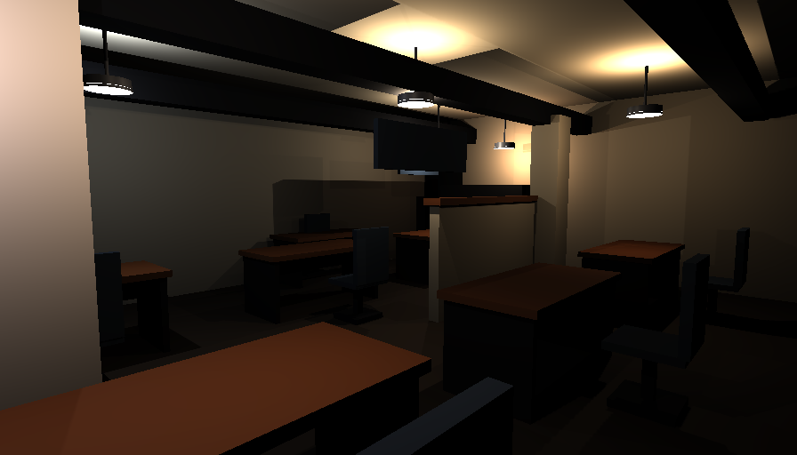
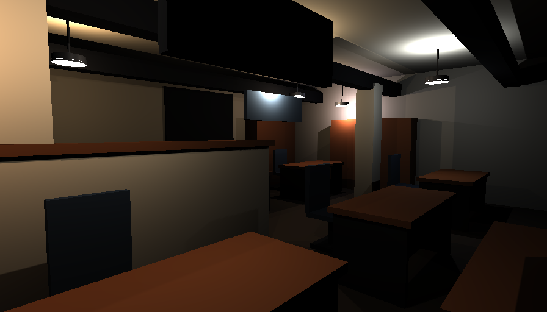
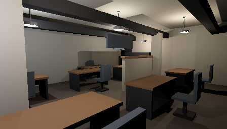

# Unity 七灯联合拟合与复杂原生房间 · E19

本轮补上两项此前缺失的证据：UrpNativeRoom 的七灯 28 维联合拟合（此前只有单灯臂），以及一个在可见性结构上接近 Classroom 的原生 URP 房间。两者的目标与每次查询都是 Unity 原生线性 HDR RGB，实时硬阴影全程保留，不使用外部渲染器、代理模型或解析光照。

**结论摘要**

- UrpNativeRoom 七灯联合（`28 = 7 × (XYZ + log I)`）在 8 个臂上全部精确恢复：位置误差 `0.00 cm`、强度误差 `0.0%`、留出视角 NRMSE `0.00%`，每臂 `856–867` 次查询（Shadow On）、`459–693` 次（Shadow Off），单臂墙钟 `12.8–27.8 s`。此前该场景只有单灯结果，本轮确认 28 维联合同样可解。
- 新建 UrpNativeComplexRoom：`9.2 × 7.4 × 3.0 m`、99 个渲染器、7 盏带灯具自遮挡的实时硬阴影点光，含横梁、立柱、隔断、吊挂挡板、六套课桌椅、货架与柜体。审计显示每盏灯在至少一个优化视角中能量占比 `≥ 0.68%`，最高单灯占比 `52.77%`；逐灯阴影差 `0.16%–3.17%`，量级比简单房间高一个数量级。
- 同一 28 维联合问题在复杂房间上不再无条件可解：`900` 次查询预算下 `0/8` 通过；提高到 `2000` 次后 `2/8` 通过，且两例都来自 0.45 倍近起点。`on/near/131` 在 `1,945` 次查询精确收敛，`on/near/733` 用 `1,951` 次仍停在 `6.30 cm / 24.3%`。
- 与 Classroom 对照：Classroom 的 28 维联合在约 `5,900` 次查询后训练 NRMSE 仍为 `27%–42%`、留出 `58%–68%`（E14）；复杂房间在 2,000 次查询即有一例精确恢复。原生黑盒拟合在"有遮挡的联合问题"上明显好于 Classroom，但仍表现为起点依赖，而不是无条件可解。
- 阴影不是复杂房间的充分解释：`off/far/733` 关闭全部阴影后仍停在 `27.86 cm / 23.4%`，说明遮挡几何造成的响应不连续和盆地结构本身就在起作用。

## 1. 实验设置

| 项目 | 取值 |
|---|---|
| 场景 | UrpNativeRoom（7 灯，15 个渲染器）；UrpNativeComplexRoom（7 灯，99 个渲染器） |
| 引擎 | Unity 2022.3.62f3c1，URP 14.0.12，Direct3D11，Linear |
| 优化视角 | 3 个，`448×256` |
| 验证视角 | 5 个，`896×512`（前 3 个与优化同视角，后 2 个留出） |
| 优化变量 | 七灯 `XYZ + log(I)`，共 28 维 |
| 查询预算 | 简单房间与复杂房间基线 `900`；复杂房间补充 `2000` |
| 渲染成本 | 1 次查询 = 3 次相机拍摄 |
| 起点 | 远起点为每灯 `0.45–0.68 m` 随机方向扰动；近起点为同一扰动缩放到 `0.45` 倍 |
| 参数门槛 | 每盏灯位置误差 ≤ 5 cm 且强度相对误差 ≤ 5% |

单臂的通过判定要求七盏灯全部达标，因此单灯 4 cm 的误差不会因为其他灯精确而通过。

## 2. UrpNativeRoom 七灯联合

| 条件 | 起点 | 种子 | 位置均值 / 最大 (cm) | 强度均值 / 最大 | 训练 NRMSE | 896 同视角 | 留出 | 查询 | 墙钟 | 结果 |
|---|---|---|---:|---:|---:|---:|---:|---:|---:|---|
| On | 远 | 131 | 0.00 / 0.00 | 0.0% / 0.0% | 94.0% → 0.0% | 0.00% | 0.00% | 863 | 27.8 s | 通过 |
| On | 近 | 131 | 0.00 / 0.00 | 0.0% / 0.0% | 73.0% → 0.0% | 0.00% | 0.00% | 860 | 26.5 s | 通过 |
| On | 远 | 733 | 0.00 / 0.00 | 0.0% / 0.0% | 90.3% → 0.0% | 0.00% | 0.00% | 856 | 26.4 s | 通过 |
| On | 近 | 733 | 0.00 / 0.00 | 0.0% / 0.0% | 71.6% → 0.0% | 0.00% | 0.00% | 867 | 27.5 s | 通过 |
| Off | 远 | 131 | 0.00 / 0.00 | 0.0% / 0.0% | 94.0% → 0.0% | 0.00% | 0.00% | 692 | 18.4 s | 通过 |
| Off | 近 | 131 | 0.00 / 0.00 | 0.0% / 0.0% | 72.9% → 0.0% | 0.00% | 0.00% | 575 | 16.9 s | 通过 |
| Off | 远 | 733 | 0.00 / 0.00 | 0.0% / 0.0% | 90.2% → 0.0% | 0.00% | 0.00% | 693 | 21.1 s | 通过 |
| Off | 近 | 733 | 0.00 / 0.00 | 0.0% / 0.0% | 71.6% → 0.0% | 0.00% | 0.00% | 459 | 12.8 s | 通过 |

远起点单灯初始距离 `51.3–67.7 cm`，近起点 `23.1–30.5 cm`。Shadow On 的四个臂都在 `15` 次 Jacobian 内收敛到机器精度；Shadow Off 更早触发 `near_zero_residual`。简单房间的响应在这些扰动范围内接近线性，因此联合维数本身不是障碍。

该结果只说明：同一原生 RGB 路径在无自遮挡、无深遮挡的规则房间里，28 维联合可解。它与 Classroom 的差异在可见性结构，不在优化器。

## 3. UrpNativeComplexRoom





场景由 `NativeComplexRoomBuilder` 以 Unity 原生几何体搭建，资产只含 URP Lit 材质、无贴图、无烘焙 GI、无实时 GI，采用 Forward+ 渲染器与实时硬阴影。灯具为 7 盏 Point Light，每盏带 3 个投影灯具部件（灯罩、吊杆、环圈），灯体本身参与遮挡。



**逐灯能量占比**（单灯单独点亮时的图像能量 / 七灯全亮能量）：

| 灯 | 位置 (m) | 视角 0 | 视角 1 | 视角 2 | 最大值 |
|---|---|---:|---:|---:|---:|
| L1 | (0.00, 2.28, 0.00) | 22.18% | 20.18% | 22.97% | 22.97% |
| L2 | (-2.30, 2.28, -1.50) | 0.13% | 53.24% | 19.46% | 53.24% |
| L3 | (2.30, 2.28, -1.50) | 52.77% | 0.13% | 0.57% | 52.77% |
| L4 | (-2.30, 2.28, 1.50) | 16.70% | 0.58% | 4.21% | 16.70% |
| L5 | (2.30, 2.28, 1.50) | 0.69% | 18.35% | 46.51% | 46.51% |
| L6 | (-3.70, 2.15, -1.10) | 4.49% | 0.00% | 4.26% | 4.49% |
| L7 | (3.70, 2.15, 1.10) | 0.68% | 5.74% | 0.01% | 5.74% |

占比分布与 Classroom 不同：Classroom 的训练视角 2 占三视角总能量 `99.96%`，实际只有两个视角提供梯度；复杂房间三个视角都承担主要能量，每盏灯都至少在一个视角里有可观占比，没有"永远不出现"的灯。

**逐灯阴影差**（关闭该灯阴影后与全开的图像 NRMSE）：

| 灯 | 视角 0 | 视角 1 | 视角 2 |
|---|---:|---:|---:|
| L1 | 3.17% | 2.95% | 3.05% |
| L2 | 1.84% | 1.41% | 2.02% |
| L3 | 0.99% | 0.97% | 0.71% |
| L4 | 2.01% | 0.85% | 0.94% |
| L5 | 0.25% | 2.04% | 0.90% |
| L6 | 0.68% | 0.23% | 0.67% |
| L7 | 0.22% | 1.72% | 0.16% |

Shadow RMS（E17 口径，On/Off 图像差除以 On 图像能量）：UrpNativeRoom `0.0012–0.0106`，复杂房间 `0.0016–0.0317`，Classroom `0.0775–0.5968`。复杂房间处在两者之间，最大单灯阴影响应是简单房间的 3 倍，但只有 Classroom 最强灯的 1/19。

## 4. 复杂房间七灯联合

**900 次查询预算（8 臂）**

| 条件 | 起点 | 种子 | 位置均值 / 最大 (cm) | 强度均值 / 最大 | 训练 NRMSE | 通过 |
|---|---|---|---:|---:|---:|---|
| On | 远 | 131 | 52.64 / 146.07 | 32.2% / 92.7% | 101.0% → 47.3% | 否 |
| On | 近 | 131 | 3.86 / 21.31 | 12.1% / 64.2% | 575.6% → 17.4% | 否 |
| On | 远 | 733 | 62.26 / 188.36 | 44.9% / 89.8% | 97.9% → 42.9% | 否 |
| On | 近 | 733 | 9.99 / 28.78 | 26.2% / 45.0% | 89.9% → 62.4% | 否 |
| Off | 远 | 131 | 69.92 / 193.33 | 54.9% / 113.3% | 100.6% → 81.6% | 否 |
| Off | 近 | 131 | 10.58 / 42.29 | 8.0% / 37.6% | 573.5% → 45.6% | 否 |
| Off | 远 | 733 | 22.29 / 66.12 | 16.0% / 52.1% | 97.2% → 66.4% | 否 |
| Off | 近 | 733 | 9.15 / 23.11 | 21.6% / 24.9% | 89.0% → 65.8% | 否 |

八个臂全部以 `budget` 停止，各用满 15 次 Jacobian。近起点的图像误差还能下降（`on/near/131` 末次试步损失 `0.030`，仍低于当前 `0.053`），说明 900 次对 28 维遮挡场景不足。

**2000 次查询预算（8 臂）**

| 条件 | 起点 | 种子 | 位置均值 / 最大 (cm) | 强度均值 / 最大 | 训练 NRMSE | 查询 | 结果 |
|---|---|---|---:|---:|---:|---:|---|
| On | 远 | 131 | 37.50 / 146.18 | 12.0% / 51.1% | 101.0% → 22.9% | 1,955 | 否 |
| On | 近 | 131 | 0.00 / 0.00 | 0.0% / 0.0% | 575.6% → 0.0% | 1,945 | 通过 |
| On | 远 | 733 | 55.65 / 146.42 | 39.5% / 168.3% | 97.9% → 28.4% | 1,963 | 否 |
| On | 近 | 733 | 6.30 / 19.36 | 24.3% / 45.0% | 89.9% → 60.8% | 1,951 | 否 |
| Off | 远 | 131 | 62.39 / 147.24 | 54.9% / 113.3% | 100.6% → 74.0% | 1,964 | 否 |
| Off | 近 | 131 | 0.00 / 0.00 | 0.0% / 0.0% | 573.5% → 0.0% | 1,891 | 通过 |
| Off | 远 | 733 | 27.86 / 136.52 | 23.4% / 88.7% | 97.2% → 52.9% | 1,963 | 否 |
| Off | 近 | 733 | 5.93 / 19.14 | 17.9% / 28.1% | 89.0% → 64.4% | 1,946 | 否 |

两点值得注意：

- 同一近起点量级（`23.8 / 22.8 / 29.0 / 29.3 / 24.3 / 28.8 / 27.0 cm`）在 seed 131 精确收敛、在 seed 733 停在 `6.30 cm / 24.3%`，末次损失 `0.369` 已不再下降。这是盆地依赖，不是预算不足。
- 关闭全部阴影不改善远起点：`off/far/733` 用 `1,963` 次查询仍为 `27.86 cm / 23.4%`，`off/far/131` 的阻塞探针达到 `332` 次、缩短试步 `31` 次。遮挡几何改变了响应结构，不只是阴影开关打开或关闭的差别。

## 5. 与 Classroom 的数字对照

| 场景 | 维数 | 预算（查询） | 最好训练 NRMSE | 最好留出 NRMSE | 位置误差 | 通过率 |
|---|---|---:|---:|---:|---:|---:|
| UrpNativeRoom | 28 | 459–867 | 0.0% | 0.0% | 0.00 cm | 8/8 |
| UrpNativeComplexRoom | 28 | 1,891–1,964 | 0.0%（近 131） | 0.0% | 0.00 cm | 2/8 |
| Classroom（E14） | 28 | ~5,900 | 27.2% | 57.5% | — | 0/9 |

Classroom 在约三倍预算下把误差留在 `27%–42%`，复杂房间在三分之一的预算内已有一例回到机器精度。差异与可见性结构一致：Classroom 吊灯有 `5,144` 三角面的贴图化灯罩、目标视角能量高度集中、部分灯具模型与墙面相交；复杂房间的灯罩是低面数圆柱，遮挡来自梁、柱、隔断与家具，边界仍然锐利但分布更均匀。

## 6. 复现命令

```text
Unity -batchmode -force-d3d11 -projectPath Light -executeMethod LightingMvp.Editor.NativeComplexRoomBuilder.BuildMenu -logFile tmp/build-complex.log
Unity -batchmode -force-d3d11 -projectPath Light -executeMethod LightingMvp.Editor.NativeRecoveryExperiment.BatchRun -bbCase e19-complex-audit -bbOutput tmp/e19 -logFile tmp/e19-complex-audit.log
Unity -batchmode -force-d3d11 -projectPath Light -executeMethod LightingMvp.Editor.NativeRecoveryExperiment.BatchRun -bbCase e19-room-joint -bbE19Budget 900 -bbOutput tmp/e19 -logFile tmp/e19-room-joint.log
Unity -batchmode -force-d3d11 -projectPath Light -executeMethod LightingMvp.Editor.NativeRecoveryExperiment.BatchRun -bbCase e19-complex-joint -bbE19Budget 900 -bbOutput tmp/e19 -logFile tmp/e19-complex-joint.log
Unity -batchmode -force-d3d11 -projectPath Light -executeMethod LightingMvp.Editor.NativeRecoveryExperiment.BatchRun -bbCase e19-complex-joint-hi -bbE19Budget 2000 -bbOutput tmp/e19 -logFile tmp/e19-complex-joint-hi.log
```

场景由 builder 生成，不进入版本库；`UrpNativeComplexRoom` 的材质、光照设置与场景资产可在本地重建。