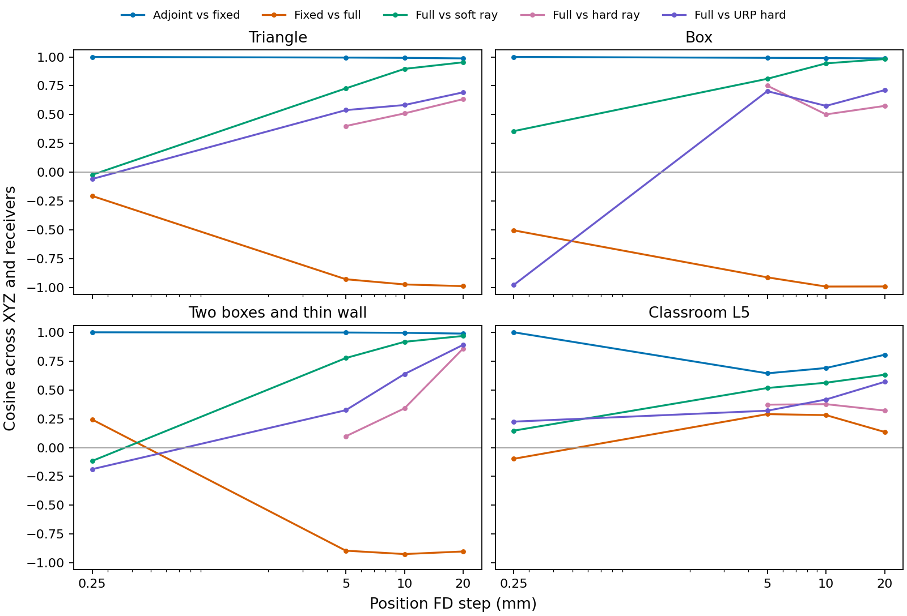
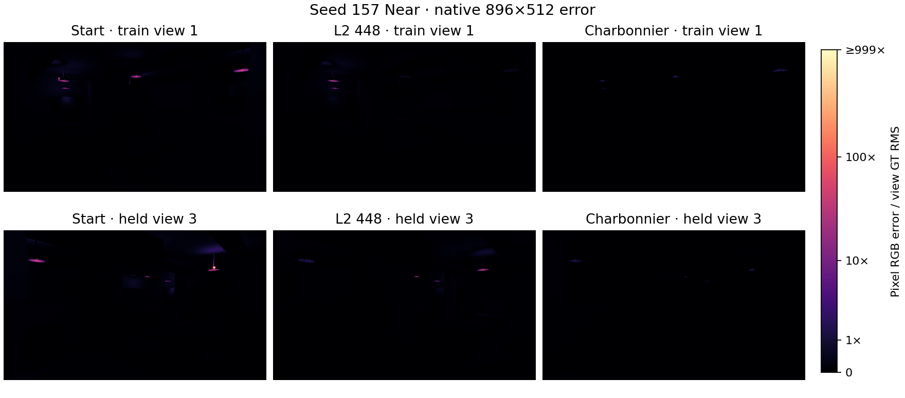
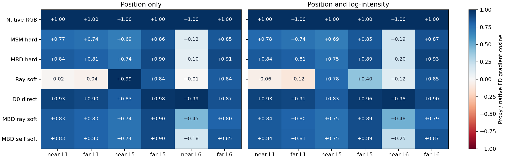

# E21 · 完整灯位差分、联合恢复与阴影代理

完成 A 的四组梯度校准和 B–E 的 108 个优化试次。E 的原生 RGB 在六个单灯起点均恢复，MBD 拟合原生硬阴影通过 0/6，拟合自身生成的匹配软目标通过 4/6。当前结果支持继续以 Native RGB + FD 为恢复基线，保留六面重渲染 MBD + FD 用于诊断。扩展多灯 MBD 和投入完整伴随的证据门槛均未达到。

实验基线为 `blackbox@22c00f93d6d1b3dccd431e51604dfa18ade41570`。A 沿用 E18 Classroom L5，并增加三组可控校准几何。B–E 使用 E19 已有的 `UrpNativeComplexRoom` 七灯基准。运行环境为 Unity `2022.3.62f3c1`、URP `14.0.12`、Direct3D11、RTX 4070 Ti SUPER 和线性 HDR。E19 场景 SHA-256 为 `f0857934e241d49d5597cd5bdb1b38b96de2fbfdb13928af764a480f7a7e8501`，Classroom 几何为 `7bf132a88258927de8a29290f12d6c22201dac96cf60d5ba47c77562d8d3e4eb`。

B–E 统一要求最终 Collider 合法，且每盏活动灯位置误差 ≤5 cm、强度相对误差 ≤5%。未参与拟合的灯固定在 GT。原生验证用视角 0–2 的 448×256 和 896×512 训练 NRMSE，以及视角 3–4 的 896×512 留出 NRMSE。对每个视角以其 GT 线性 RGB 能量归一化，跨视角先平均平方误差再开方。位置以米计步，强度以自然对数步长计。`Q` 是每组优化内的调用上限，含基点、FD、候选和 E 的原生验收。初末复拍、目标采集和独立诊断另计，渲染次数与耗时随组记录。一次相机目标调用拍摄三张训练图，解析表面目标的计算量取决于活动灯数，因此相同 `Q` 只匹配调用上限。

[试次表](trials.csv) · [运行元数据和参数快照](stage-summary.json) · [原始数据](raw-data.zip) · [A 梯度汇总](gradient-pooled.csv)

## A · 固定贴图和完整灯位差分

比较 Frozen Map Adjoint、Fixed Map FD、Full MBD FD、独立三角网格硬射线、17-tap 圆盘软射线和 URP 原生硬阴影。三组校准几何各测 1,764 个接收点，Classroom 在 E18 L5 的 30 cm、方向 0 起点测 1,280 个点。每次位置扰动分别生成六面 128² 矩纹理，使用 4× MSAA 和半径 2 像素跨面滤波。0.25、5、10、20 mm 均做 XYZ 中心差分。

下表在 10 mm 下把三轴与所有接收点拼接为向量。软射线与 MBD 的滤波核近似匹配，原生参考还受图集采样与阴影偏置影响。

| 场景 | Adjoint / Fixed FD 余弦 | Fixed / Full FD 余弦 | Full FD / 软射线余弦 | Full FD / URP 硬阴影余弦 |
|---|---:|---:|---:|---:|
| 单三角形 | 0.992 | −0.973 | 0.897 | 0.583 |
| 单 Box | 0.990 | −0.991 | 0.944 | 0.575 |
| 双层 Box + 薄墙 | 0.995 | −0.923 | 0.917 | 0.638 |
| Classroom L5 | 0.690 | +0.282 | 0.563 | 0.417 |

在 0.25 mm 下，固定贴图两种计算的余弦均接近 1。四组硬射线参考在这个尺度上全为零，余弦留空。10 mm 时，单独移动投影相机、保留 caster 径向深度参考点，得到的梯度范数为完整 FD 的 1.41–1.84 倍（三组校准）和 1.04 倍（Classroom）。Classroom 单独移动 caster 径向深度、接收点 UV 原点、接收点查询深度原点分别为 0.28、0.49、0.63 倍。固定贴图 FD 加上整体贴图变化 FD，在该场景仍有相对完整梯度范数 16.1% 的差项。独立扰动改变覆盖或采样命中，有限步长下各项会抵消或交互。四组均未测到无效伴随、退化前向结果、非有限值和根极限。A 的软射线沿用 E20 接收平面圆盘近似，实际几何点的固定深度软参考在 E 单独核验。继续采用完整重渲染 FD 产生代理提案，固定贴图伴随保留作为子问题诊断。



[独立投影和深度扰动](figures/gradient-components.png)

## B · Collider 探测与信任域

比较 B0 Strict、B1 Probe-through 和 B2 Full-through。B0 检查探测及候选，B1 仅放宽探测的 Collider 检查，B2 同时放宽中间候选。三者始终检查参数与测量区域边界，均从已接受的合法位姿返回最终解。初始位置半径 0.24 m、强度半径 0.28 log，按实际/预测下降比更新。合法的两侧可用中心差分，一侧可用时优先尝试二阶单边差分，必要时使用一阶。求解为每组保留最多 420 次评估。

| 起点 | 阴影 | 0.5 cm | 2 cm | 5 cm |
|---|---|---:|---:|---:|
| 131 Near L6 | Off | 3/3 | 3/3 | 3/3 |
| 733 Far L1 | On | 3/3 | 3/3 | 3/3 |
| Cross Geometry L1 | On | 3/3 | 0/3 | 3/3 |
| 157 Far L3 | Off | 3/3 | 3/3 | 0/3 |

三种策略各通过 10/12。历史 Strict L6 停在 8.61 cm、4.15%，E21 的 B0 在三个步长下均恢复。历史 A1 Far L3 停在 87.09 cm、20.89%，旧终点的 +Y 探测在三个步长均越过测量区域边界。E21 的 Far L3 在 0.5/2 cm 恢复，在 5 cm 时三策略均停在 87.64 cm、19.77%，各有 13 个探测被区域边界阻断。新信任域和不同物理步长共同改善了历史失败，这组跨版本对照无法分离二者的贡献。

Cross Geometry L1 的 2 cm 组无探测阻断，三策略均停在 56.45 cm、21.41%。5 cm 下，B0 遇到一次阻断仍在 181 次调用内通过；B1 渲染一次 Collider 非法探测并在 222 次通过；B2 渲染 14 次非法探测和 4 次非法候选，暂时接受两个非法候选，最终在第 255 次调用内回到合法解。该起点允许穿越后能恢复，严格路径同样可达。所有 B 组均无零列。

[策略与步长对照](figures/probe-policies.png)

## C · D0 对联合优化器的诊断

以 E19 seed733 Near 为共同起点，固定 4,096 个世界表面采样点，拟合逐灯原生 Shadow Off 入射辐照度。解析预测复用 URP 对应的距离衰减与 Lambert 入射项。C0 给各灯分配近似相等的 4D 子预算。C1 逐灯循环，每次最多一个 Jacobian 迭代，换灯时重置局部阻尼。C2 使用共享 LM 阻尼与共享信任域尺度。C3 同时提出七灯更新，各灯 4×4 法方程块独立阻尼、独立调节位置与强度半径。C4 沿用 C2，按灯的 GT 面积平均能量归一化平方残差。初始位置 FD 1.5 cm、log 强度 FD 0.04。

| 方法 | 28D，Q≤520 最大位置 / 强度误差 | 28D，Q≤1,575 最大位置 / 强度误差 |
|---|---|---|
| C0 独立 4D | 8.74 cm / 0.62%，失败 | 1.46 cm / 0.55%，通过 |
| C1 循环 BCD | 5.08 cm / 14.38%，失败 | 3.33 cm / 7.42%，失败 |
| C2 共享 LM | 2.01 cm / 3.94%，通过 | <0.01 cm / <0.01%，通过 |
| C3 逐灯阻尼与半径 | 1.16 cm / 1.10%，通过 | 0.21 cm / 0.26%，通过 |
| C4 逐灯残差归一化 | 5.48 cm / 37.55%，失败 | 1.54 cm / 4.06%，通过 |

C2/C3 初始有效秩 28，条件数 56.75。C4 初始条件数 66.25，紧预算结果更差。逐灯 oracle 的 D0 Gram 非对角灯块实测全为零，低预算差异与阻尼、信任域和调用分配有关。复核使用日志内的子块初末损失计数，20 组的最终参数和查询数逐项一致。

双灯在相同 520 次上限下，L5+L7 的 C1 强度误差 5.29%，其余四臂通过，L2+L7 五臂均通过。独立的混合原生 Shadow Off RGB 局部差分验证了两对灯的耦合排序。L5+L7 跨灯列绝对余弦最大值 0.542、RMS 0.173；L2+L7 为 0.000470、0.000148。该混合 RGB 量测未用于 D0 优化。D0 测试说明这一场景的逐灯观测下 28D 可解，混合 RGB 恢复仍要面对跨灯耦合与观测差异。

[D0 参数与留出误差](figures/d0-recovery.png)

## D · RGB 热点、分辨率与留出误差

七灯同时拟合，使用 seed131 和 seed157 Near、Shadow Off、每组 520 次评估。对照原始 448×256 L2、Huber、Charbonnier、896×512 L2，以及先对 896×512 线性 HDR 做 2×2 分块平均再算 L2。Huber 与 Charbonnier 对每像素的 RGB 向量残差取范数，尺度为同视角 GT 向量 RMS 的 0.25 倍。热点比例始终从未经稳健权重变换的原生平方误差计算。

两个起点在 896×512 的十个视角读数里，Top 1% 像素占 99.37%–99.999% 的误差，Top 0.1% 占 89.29%–99.985%。seed131 训练 v1 在同一位姿下的 NRMSE 由 448×256 的 953.65% 变为原生 896×512 的 1,372.46%，后者做 2×2 平均仍为 1,137.38%。分辨率改变误差量级，热点在像素覆盖平均后依然存在。较大 NRMSE 来自亮斑与该视角较低的参考总能量。

| 目标 | 131 Near 最大位置 / 强度误差 | 131 留出 | 157 Near 最大位置 / 强度误差 | 157 留出 |
|---|---|---:|---|---:|
| L2 448 | 67.50 cm / 35.17% | 62.52% | 40.07 cm / 36.95% | 49.12% |
| Huber | 39.22 cm / 15.92% | 45.17% | 8.30 cm / 7.09% | 6.45% |
| Charbonnier | 47.20 cm / 18.48% | 77.52% | 8.33 cm / 7.33% | 6.01% |
| L2 896 | 64.30 cm / 36.37% | 66.23% | 39.40 cm / 37.08% | 70.51% |
| 2×2 Footprint | 63.14 cm / 35.19% | 61.39% | 29.22 cm / 30.88% | 54.11% |

10 组均未通过参数门槛。seed157 的稳健损失明显改善原生训练、留出和参数误差。seed131 的 Huber 在 448 原生训练由 L2 的 69.53% 改善至 58.11%，896 训练复拍却由 108.81% 升到 165.90%。高分辨率目标与像素覆盖平均也未在两种起点稳定提升恢复。训练、留出与参数应同时对照。



[各视角热点占比](figures/rgb-hotspot-share.png) · [恢复和留出对照](figures/rgb-recovery.png)

## E · 代理目标同条件对照

固定 seed733 的 L1、L5、L6 Near/Far 六个起点，单灯 4D，每组最多 350 次评估，位置 FD 2 cm、log 强度 FD 0.04。所有表面目标共用 1,536 个世界表面采样点，按面积加权后用各自的 GT 表面能量归一化。Native RGB 直接拟合原生 448×256 线性 HDR。MSM、MBD 和 Ray Soft 乘相同解析辐照度，拟合逐灯原生有阴影表面量。D0 拟合逐灯无阴影 oracle。代理候选还必须使混合原生 Shadow On RGB 严格下降，六类代理触发了 895 次候选验收，414 次被接受。训练画面与留出检查口径和原生基线一致。

MSM 与 MBD 每次灯位扰动重渲染六面 128² 矩纹理，使用 4× MSAA 与半径 2 像素的滤波。独立软射线使用半径 `3.15/128` 的 13-tap 角圆盘，按立方体视锥近面截断，保留原接收点径向深度并采用同一 1.2 cm 深度偏置。其双面几何相交与近似角滤波独立于栅格矩估计。首轮沿用移动接收点的参考方法，在室内网格产生了过强遮挡。表中采用固定接收深度的完整复跑。MBD 同时拟合独立软射线目标和自身生成的同分辨率、同滤波参数软目标。后一臂提供目标完全匹配时的合成诊断。

| 方法 | 通过 | 通过的起点 | 评估次数中位数 | 每组秒数中位数 |
|---|---:|---|---:|---:|
| Native RGB | 6/6 | 全部 | 86.5 | 3.23 |
| MSM → 原生硬阴影 | 4/6 | L1 Near、L5 Far、L6 Near/Far | 187 | 1.98 |
| MBD → 原生硬阴影 | 0/6 | — | 233.5 | 2.38 |
| Ray Soft → 原生硬阴影 | 0/6 | — | 143.5 | 17.57 |
| D0 → 无阴影 oracle | 6/6 | 全部 | 68 | 1.08 |
| MBD → 独立近似同尺度 Ray Soft | 0/6 | — | 185 | 2.23 |
| MBD → 自身匹配软目标 | 4/6 | L1 Near、L5 Far、L6 Near/Far | 215 | 2.21 |

**硬阴影目标失配有直接证据。** MBD 拟合原生硬阴影时，六个起点的 XYZ+log 强度梯度与原生训练梯度余弦均为正，范围 0.196–0.930。把参数固定在 GT，其表面 NRMSE 在 L1、L5、L6 分别仍为 1.41%、2.30%、13.08%。L6 Near 收敛到位置误差 0.38 cm、强度误差 14.84% 的解，该位姿的代理 NRMSE 只有 3.22%，明显低于 GT。初始方向有用也可能被错误的代理最优点所限制。原生验收保护训练 RGB，参数和留出仍须独立验证。

自身匹配软目标在 GT 的模型偏差降至数值零，增加了四组恢复。L1 Far 和 L5 Near 仍失败，目标匹配后仍有起点及搜索路径限制。独立软目标的 L1 Near 达到 3.80 cm、5.27%，其余五组也未同时通过位置和强度门槛。这些结果尚不足以支持进入双灯或七灯 MBD 恢复。逐灯 D0 的 6/6 继续作为可辨识性诊断，观测须来自逐灯分离的表面数据。



[参数与留出误差](figures/proxy-recovery.png)

## 复跑和原始记录

在仓库根目录运行以下命令。`--e19-project` 提供现有 E19 的 `Assets/Scenes` 与 `Assets/Settings`，`--classroom-project` 提供 E17 的 `Assets/ClassroomScale`。准备命令把这些场景与当前源码复制到隔离项目。B 默认从仓库内 E20 压缩包读取两份基线汇总，可以显式传 `--e20`、`--mbd` 指向对应结果目录。用 `--stages` 选单阶段，`--resume` 跳过已有完成标记的阶段。报告使用 Python 3.10、NumPy 2.2.6 和 Matplotlib 3.10.9 生成。[E19 场景说明](../blackbox-e19/README.md) · [E17 Classroom 说明](../blackbox-e17/README.md)

```powershell
python mvp/blackbox_e21.py prepare --project results/e21-work/project --e19-project results/e20-work/project-proxy --classroom-project results/e17-work/project
python mvp/blackbox_e21.py run --unity results/e17-work/Unity-2022.3.62f3c1/Editor/Unity.exe --project results/e21-work/project --output results/e21
python mvp/blackbox_e21.py report --output results/e21 --report-dir docs/blackbox-e21
```

压缩包内的 `source-files-sha256.json` 对应各阶段实际运行的源码和实验资产。A 提供逐接收点的 `derivatives.csv`、`receivers.csv` 和无效状态计数。B–E 的 `queries.csv` 包含实际每次渲染或解析求值的参数、物理位移与合法性，`jacobians.csv` 提供列范数、梯度、有效步长、模板、秩和谱，`gram.csv` 记录完整法方程 Gram，`decisions.csv` 含 `rho`、预测/实际下降、步长、阻尼和信任域。C 的 `native-pair-cross.csv` 与逐灯 oracle 文件分开存放，D 的 `hotspots.csv` 保留三个分辨率口径与 Top 0.1/1/5%。E 的 `proxy-direction.csv` 记录各轴差分，`proxy-target-fit.csv` 记录 GT 处的模型偏差，`visibility-status.csv` 保留无效值与根极限计数。逐组 `trial.json` 保留最初、最终参数与每个视角 NRMSE。Unity 完整日志和高分辨率 EXR 位于本地 `results/e21`。
