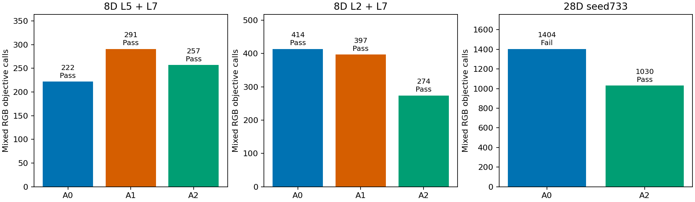
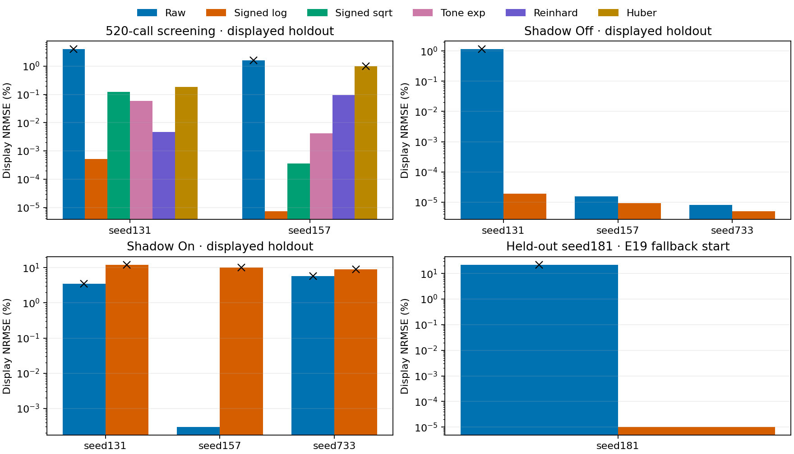
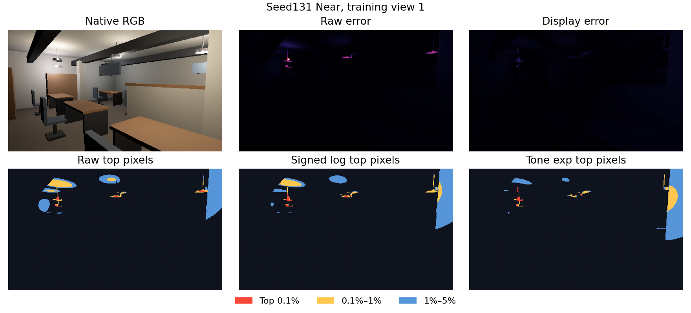
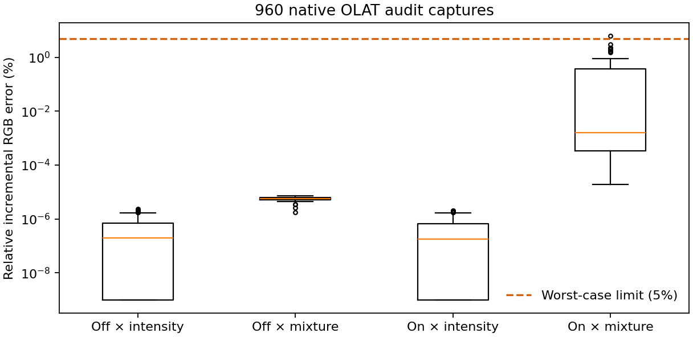
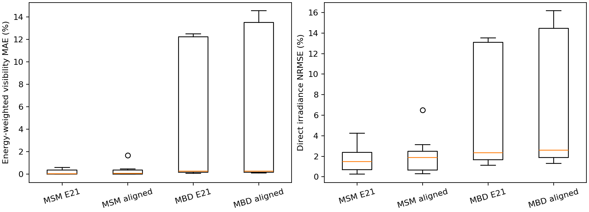

# E22 · 混合 RGB 联合恢复、HDR 压缩与几何分组

完成 A–E 的 48 个对照臂，其中 3 个复用完全匹配的 Raw 求解记录并独立复拍。按灯块缩放阻尼的 Dense LM 和 Signed Log 在关闭阴影的 E19 七灯基准上提高了参数恢复。Signed Log 在三个 Near 种子通过 3/3，Raw L2 通过 2/3，独立 seed181 也复现了收益。开启硬阴影时，Signed Log 通过 0/3，Raw L2 通过 1/3，Signed Log 的显示域留出误差在三组均较高。因此 Signed Log 的推进范围限定在 Shadow Off。

使用 `blackbox@7a2c0b4d601610f554774f5301995ca386001827`、已有 E19 `UrpNativeComplexRoom`（SHA-256 `f0857934e241d49d5597cd5bdb1b38b96de2fbfdb13928af764a480f7a7e8501`）、Unity 2022.3.62f3c1、URP 14.0.12、Direct3D11、RTX 4070 Ti SUPER。灯型、颜色、Range 和灯数固定，活动灯更新 XYZ 与 log(I)，非活动灯固定在 GT。正式 A–C 臂只读取混合原生 HDR 目标。关闭动态 GI、自动曝光和后处理，目标映射只在损失计算中应用。

训练用视角 0–2 的 448×256 HDR；同三个视角在 896×512 独立复拍，视角 3–4 的 896×512 用于留出。Raw 和固定显示域均先按各视角 GT 能量归一化，平均平方误差后开方。固定显示映射是曝光 1 的 `sRGB(1−exp(−max(RGB,0)))`。参数门槛为每盏活动灯的位置误差 ≤5 cm、强度相对误差 ≤5%，且最终 Collider 合法。默认 Strict，位置 FD 2 cm，log 强度 FD 0.04，信任域初始半径分别为 0.24 m 和 0.28 log。

[试次表](trials.csv) · [参数快照、判定与阶段元数据](stage-summary.json) · [原始 CSV/JSON](raw-data.zip)

## A · Mixed RGB 法方程与差分尺度

A0 使用 E21 的共享阻尼 Dense LM。A1 求解时仅保留各灯的 4×4 Gram 对角块。A2 保留整个 `H = JᵀJ`，在灯块内对四轴加同一阻尼系数 `λ max(max diag(H_l), 10⁻⁶ max diag(H), 10⁻¹⁰)`。三者都在相同的混合 RGB 残差上计算完整 `H` 与 `g = Jᵀr`，候选按完整模型的 `−2gᵀΔ−ΔᵀHΔ` 和真实损失下降验收。所有活动灯同时更新；逐灯记录提案位移，实际下降只对混合目标定义。

| seed733 Near，Shadow Off | A0 | A1 | A2 |
|---|---:|---:|---:|
| L5+L7，8D | 222 Q，通过 | 291 Q，通过 | 257 Q，通过 |
| L2+L7，8D | 414 Q，通过 | 397 Q，通过 | 274 Q，通过 |
| 七灯，28D | 1,404 Q，失败 | — | 1,030 Q，通过 |

初始跨灯列最大绝对余弦为 L5+L7 的 0.54203 与 L2+L7 的 0.000470。8D 同通过率下按两对合计至少减少 15% 渲染且终点质量相当筛选。A2 合计从 636 降到 531 Q，收益来自 L2+L7。28D 以 1,575 Q 封顶，A0 停在 10.35 cm、17.05% 强度误差，A2 回到数值精度并在 688 Q、2,064 张训练拍摄时首次达标。后续 B、C 使用 A2。

同设置峰值内存复跑中，L5+L7 的 A0 早一轮 Jacobian 达到近零停止阈值，录得 205 Q，其余 19 臂调用数一致，20 臂参数通过结果一致。按复跑计，A2 的 8D 总调用减少 14.2%。此处保留首次筛选及其事先选中 A2 的迁移结果，七灯对照在内存复跑中也复现。

A3 复现了两个 E21 严格策略的失败。Cross Geometry L1 的固定 2 cm 在 89 Q 停滞，0.5 cm 和 5 cm 均可恢复。自适应臂只在停滞后重新采样，用同一次合法的 8 mm 验证位移比较预测与实际下降，选出 5 cm，最终在 308 Q 恢复，固定 5 cm 在 181 Q 恢复。seed157 Far L3 在 5 cm 复现失败；重采样仍选 5 cm，298 Q 后仍停在 87.64 cm、19.77%。该验证在一个局部方向上改善模型预测，对逃离远处错误盆地的作用有限。



## B · HDR 压缩的筛选与独立验证

相同候选和目标映射后，用每视角目标能量归一化。B0 用 Raw L2，B1/B2 分别复用 E14 Signed Log/Signed Sqrt，B3 将固定显示映射直接用于损失，B4 使用带固定尺度的 Reinhard 再转 sRGB，B5 复用 E21 RGB 向量 Huber（每视角 `δ=0.25×GT RGB RMS`）。正 RGB 通道的全训练视角 P90 在各 Shadow 状态固定，Off 约 0.42406，On 约 0.38418，保留候选浮点 HDR。B3 保持曝光 1；seed131 v1 的 GT 显示饱和通道（≥0.99）占 0.20%。所有 B 候选用所选目标的 `rho` 验收。重复 GT 拍摄与标量/残差平方和核对见原始记录。

| 520 Q 筛选，Shadow Off | 参数通过 | seed131 / seed157 显示留出 NRMSE |
|---|---:|---:|
| Raw | 0/2 | 3.9919% / 1.6203% |
| Signed Log | 2/2 | 0.00053% / 0.00001% |
| Signed Sqrt | 2/2 | 0.12318% / 0.00036% |
| Tone-Exp | 2/2 | 0.05837% / 0.00413% |
| Tone-Reinhard | 2/2 | 0.00476% / 0.09454% |
| Huber | 1/2 | 0.18099% / 1.00225% |

按通过数、显示留出低于 Raw 的种子数、平均相对显示误差和参数误差依次排序，保留 Signed Log。E21 Raw/Huber 的共享阻尼与 E22 A2 设置不同，六目标均以 A2 实跑。高预算验证复用 A28 的 seed733 Off Raw 参数与原始求解开销，并独立复拍和核对显示误差。

| 1,575 Q 验证 | Raw 终点位置 / 强度 | Signed Log 终点位置 / 强度 | Raw / Log 显示留出 | Raw / Log 实际 Q |
|---|---|---|---:|---:|
| 131 Near Off | 14.08 cm / 20.00% | <0.01 cm / <0.01% | 1.1521% / <0.001% | 1,525 / 571 |
| 157 Near Off | <0.01 cm / <0.01% | <0.01 cm / <0.01% | 两者 <0.001% | 1,031 / 457 |
| 733 Near Off | <0.01 cm / <0.01% | <0.01 cm / <0.01% | 两者 <0.001% | 1,030 / 400 |
| 131 Near On | 17.46 cm / 41.14% | 30.21 cm / 18.84% | 3.5240% / 12.2635% | 1,053 / 1,235 |
| 157 Near On | <0.01 cm / <0.01% | 29.31 cm / 13.17% | <0.001% / 10.1372% | 1,487 / 1,566 |
| 733 Near On | 9.57 cm / 9.95% | 29.99 cm / 10.30% | 5.8584% / 9.0173% | 1,553 / 1,558 |
| 独立 181 Off | 75.96 cm / 350.00% | <0.01 cm / <0.01% | 22.1219% / <0.001% | 1,543 / 571 |

Off 下三个种子显示留出数值均下降，157 和 733 的差异发生在双方都低于 0.001% 的水平。131 的参数通过率和独立 181 的恢复提供了更大的验证差异。seed181 的 E19 Near 插值触发合法性回退，保留预定种子和原始回退规则，实际偏移 55.13–63.22 cm。其 Signed Log 在 343 Q、1,029 张训练拍摄时首次达标。On 下 Signed Log 的显示留出没有改善。733 On 的 Raw 留出由 861.85% 降至 47.48% 同时出现显示留出和位置误差上升，记录为视觉与物理精度权衡。Far 扩展和 60/40 两阶段损失的执行条件均未满足。



### B3 · 热点是像素误差和导数的共同问题

在 seed131、157 的初始状态与 12 个筛选终点保存 Raw、各自目标和固定显示域像素误差。两初始状态和首个失败终点各共享 56 个原生 FD 目标调用（168 张训练拍摄），从同一组 HDR 图重建六种残差的 `Jᵀr` 和 Gram。Raw Top 0.1%/1%/5% 的固定像素区域分别参与乘积重算。梯度范数比有时略大于 1，因为区域外分量可以抵消。

在 seed131 初始的训练 v1，Raw 自身 Top 1% 占 99.9914% 的平方误差，Signed Log 自身 Top 1% 占 62.38%，Tone-Exp 占 18.86%。跨三个训练视角以 Raw Top 1% 固定区域重算后，Raw 的梯度范数比约 100%、Gram Frobenius 比 99.96%；Signed Log 为 98.82% / 77.25%，Tone-Exp 为 34.80% / 45.39%。Signed Log 的完整 `J` 条件数由 Raw 的 3,129 降至 76.14，seed157 为 626.27 降至 17.90。像素损失占比与局部求解影响各有独立量测。

seed131 v1 的峰值像素落在 `Fixture L05 Shade` 的 `ComplexMetal`，距离 L5 约 1.50 cm。关闭 L5 的 RGB 变化范数为 4,769.22，关闭镜面项为 166.37，打开阴影为 0，当前 Raw 像素误差范数为 4,769.18。该峰值主要随近光源能量变化。seed157 同视角 Top 0.1% 的 Raw 误差中，约 99.47% 落在几何边界像素。固定热点区域内，将 896×512 按 2×2 线性 HDR 平均后，seed131 和 seed157 的平方误差分别为原探测的 1.28 倍和 0.64 倍。全部采样点的几何、最近灯、逐灯关闭量、镜面和阴影开关量保存在原始表，用于区分归因。



[热点对梯度和 Gram 的影响](figures/hotspot-jacobian.png)

## C · 固定表面 patch 权重

复用 ProxyGeometry 的世界坐标和法线捕获，并记录 Renderer/Material ID。密集替换栅格独立和 URP 原生相机深度对齐，三视角 344,064 个像素中 344,061 个通过重投影与深度一致性。每视角最大重投影 <0.002 px。位置按 0.25 m 划格，同 Renderer、Material、法线方向分别成组。小于四个像素的 patch 与配准失败点回退为普通权重 1。每视角分别把 `1/√n_patch` 约束在 [0.25,4] 并归一化至平均 1，保留 2,411–2,481 个有效 patch。固定分组不使用误差排名或灯位真值。

C0 复用 B-Off 的 Signed Log。C1 两个种子均通过，C0 也为 2/2。C1 的实际 Q 为 571 / 514，C0 为 571 / 457；Signed Log 加 patch 后两组留出仍接近零，未出现稳定的额外视觉收益。C2 的 patch 均值项与额外起点扩展保留为条件入口。几何采集单独计量为三次属性栅格和三次原生深度捕获。

## D · OLAT 线性审计与结构化强度列

GT、seed733 Near、seed131 Near 的五个视角均审计，分别测试单位灯的 0.5/1/2 强度，以及 L5+L7、L2+L7 和七灯原生混合。基于相同场景的暗图与单位灯响应，误差按真实增量 RGB 归一化。Shadow Off 与 On 各 360 个比较、480 次相机拍摄。

| 状态 | 中位相对误差 | 最差相对误差 | 门槛 |
|---|---:|---:|---|
| Off | 3.07×10⁻⁷% | 7.32×10⁻⁶% | 通过 |
| On | 2.58×10⁻⁷% | 6.197% | 失败 |

最差样本是 seed733 Near v1 的七灯混合，其增量 Top 1% 区域误差为 7.753%。同一视角单灯原生 atlas 用 512² 面，七灯变为 256²，位置与采样映射也改变。开启阴影的结构化方法未通过前置审计。

Off 下 D1 保持完整混合目标，位置列仍通过 FD 获取，强度列取当前 `a_l R_l` 并换算为归一化 log(I) 坐标。原本的 A2 和 D1 在 L5+L7 均通过；D1 的两条初始强度列与完整 FD 方向余弦高于 0.999999，范数相对误差约 0.0267%。完整目标调用从 257 降到 197，训练相机成本从 771 次降至 591 次混合 + 90 次 OLAT，另计 3 次共享暗场准备。包含独立强度列审计与有界 NNLS 诊断后的采集总数另列。NNLS 只在共享起点位置核对混合图预测与原生复拍。

纳入暗场后，8D 相机总数减少 11.3%，触发七灯复核。28D 两臂均通过，完整目标从 1,030 降至 778 Q，训练成本从 3,090 次降到 2,334 次混合 + 369 次 OLAT + 3 次暗场（减少 12.4%）。优化时间由 22.71 s 变为 21.46 s。加上暗场，D1 首次达标约 1,815 张拍摄，A2 为 2,064 张。七灯全阶段 140 次单位响应请求仅 10 次命中原位缓存，其中包括独立诊断。固定位置 NNLS 的预测与混合原生复拍一致，本轮的联合方案采用结构化 Jacobian。

对同一个 28D 首提案，全 FD 和结构化 Jacobian 分别预测下降 0.133094 和 0.133100，原生复拍测得 −3.41638，信任域拒绝了该次更新。强度列匹配后，位置非线性仍会限制局部预测。[同一首步的两种全局下降预测](olat-prediction-comparison.csv)



## E · 限额阴影代理校准

Shadow On 的恢复率下降触发 E。L1/L5/L6 在 GT 和两侧 2 cm 合法扰动共用 1,536 个接收点。原生保持七灯及相同 atlas，实测 2048²、42 个 256² 面。MSM/MBD 使用同一组 99 个 Caster、相同 Cull/Alpha Clip、近远面和按原生 256² 面换算的 URP 点灯 Caster 深度偏置；点灯法线偏置为 0。矩代理用 128²、4× MSAA、Blur 2，仍用各自的有符号或无符号矩估计，统计原生与独立 cubemap 的剩余保真差异。原生 cubemap 面有 2.03° guard band。按未参与 GT 标定的扰动、能量加权可见性与直接辐照度两项均相对改善至少 10%，且方向不显著退化，判定进入下一轮恢复的条件。

| 非 GT 扰动中位数 | E21 能量加权可见性 MAE → 对齐 | E21 辐照度 NRMSE → 对齐 | 辐照度梯度余弦 → 对齐 |
|---|---:|---:|---:|
| MSM | 0.0522% → 0.0665% | 1.484% → 1.874% | 0.9960 → 0.9991 |
| MBD | 0.2679% → 0.2835% | 2.335% → 2.590% | 0.9959 → 0.9988 |

匹配后方向略有改善，两个绝对拟合指标均退化。代理继续停留在校准用途，本轮未进入单灯代理恢复复跑或多灯代理开发。



## 复跑和成本口径

在仓库根目录运行，复用已准备的 E19 场景和设置。Python 3.10 加 NumPy、Matplotlib 用于报表。下面的求解器和映射参数为本轮实际选择，可以用 `choose` 在每个选择阶段重新求出。`qualify` 汇总各条件门槛。

```powershell
$unityE22 = 'results/e17-work/Unity-2022.3.62f3c1/Editor/Unity.exe'
$projectE22 = 'results/e22-work/project'
$outE22 = 'results/e22-replay'
python mvp/blackbox_e22.py prepare --project $projectE22 --e19-project results/e20-work/project-proxy
python mvp/blackbox_e22.py run --unity $unityE22 --project $projectE22 --output $outE22 --stages a8
python mvp/blackbox_e22.py choose --output $outE22 --phase a8
python mvp/blackbox_e22.py run --unity $unityE22 --project $projectE22 --output $outE22 --stages a28 --solver A2
python mvp/blackbox_e22.py choose --output $outE22 --phase a28
python mvp/blackbox_e22.py run --unity $unityE22 --project $projectE22 --output $outE22 --stages b-screen --solver A2
python mvp/blackbox_e22.py choose --output $outE22 --phase b-screen
python mvp/blackbox_e22.py run --unity $unityE22 --project $projectE22 --output $outE22 --stages b-off b-on b-confirm d-audit c b-hotspots a-fd --solver A2 --mapping B1
python mvp/blackbox_e22.py run --unity $unityE22 --project $projectE22 --output $outE22 --stages d-8d e-calibration d-28d --solver A2 --mapping B1
python mvp/blackbox_e22.py qualify --output $outE22
python mvp/blackbox_e22.py report --output $outE22 --report-dir docs/blackbox-e22
```

`Q` 计优化内完整目标调用。一次 Raw 或压缩混合 RGB 目标通常拍三张训练图。解析强度列的单灯响应、重复采集、诊断、几何和原生验收分别计量。`optimizationCameras` 表示该方法原始优化成本，`newOptimizationCameras` 便于识别复用；复用臂仍记录新评价开销，首次达标时刻可追溯到原始臂。`shadowed_rgb_cameras` 为开阴影原生相机次数，OLAT 和 E 同时保留 atlas 面布局、代理六面渲染和读回/提交耗时。原生 atlas 的 GPU 时间未从整帧渲染单独分离。显存为 Unity 返回的峰值采样图形驱动分配；常驻内存用 Windows 工作集。早期三阶段的常驻内存由同配置独立复跑提供，分别在 `repeatPeakWorkingBytes`、`memory-recheck/` 留档。原始日志和高分辨率 EXR 位于 `results/e22`。最终源码通过 E21-A、C、E 的 Unity 短程回归检查。[E19 场景来源](../blackbox-e19/README.md) · [E21 基线](../blackbox-e21/README.md)
