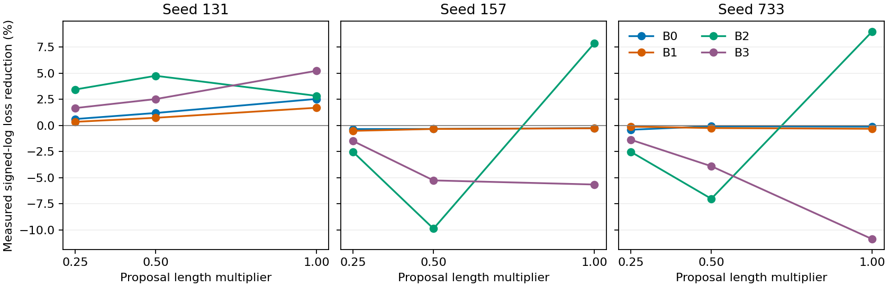
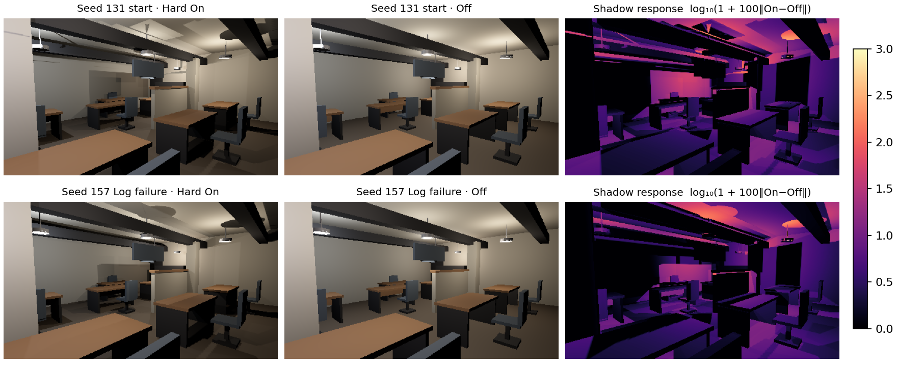
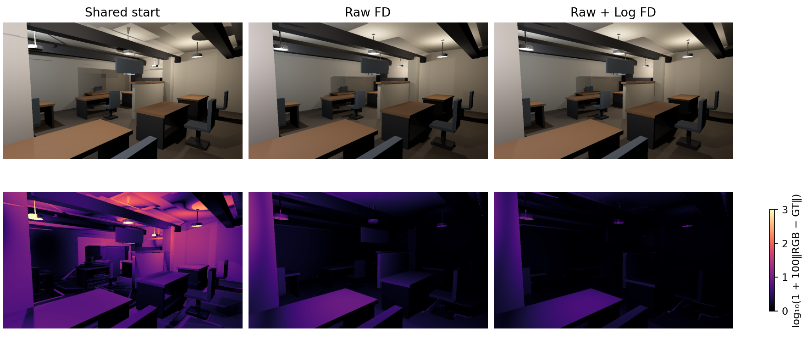
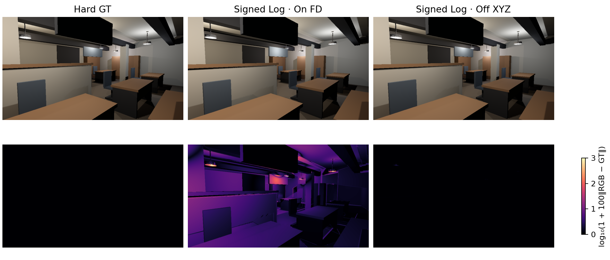

# E23 · 原生阴影响应分解与 Shadow On 七灯恢复

在相同的 4,725 张相机上限下，**Signed Log + Off XYZ + 原生 On 强度 FD（B2）通过 2/3**，Raw + 完整 On FD 通过 1/3，Signed Log + 完整 On FD 通过 0/3。B2 恢复了原本失败的 seed733，并保留 seed157 的参数通过。seed131 仍失败。seed157 的 Raw 基线更接近精确解，B2 的留出显示 NRMSE 从 0.00030% 增至 0.5599%。

结果文件包括[试次表](trials.csv)、[阶段判定与参数快照](stage-summary.json)、[梯度分解](gradient-decomposition.csv)、[提案复拍](direction-probes.csv)、[逐灯逐面 Atlas](atlas-layout.csv)和[原始台账及参数快照](raw-data.zip)。原始台账内含逐次目标查询、Hard/Off/Soft 模型查询、实际 stencil、Gram、阻尼、预测下降、实际下降、rho 和复拍数据，以及复用臂对应的 E22 原始轨迹。

## 实验配置

- 基线为 E22 的 `blackbox@d8a45f2da7c47ac597ceb7a13ed0109bd4ac4d8c`。主场景复用 E19 已有 Unity 原生 `UrpNativeComplexRoom`，SHA-256 为 `f0857934e241d49d5597cd5bdb1b38b96de2fbfdb13928af764a480f7a7e8501`。七盏 Point Light 保持 E19 的固定冷暖色、Range、强度坐标和碰撞约束。统一成纯白会改动 E22 的精确 GT，所以沿用了场景已经保存的灯色。
- Unity 2022.3.62f3c1、URP 14.0.12、D3D11、RTX 4070 Ti SUPER。优化用相同的三个 448×256 原生线性 HDR 视角，896×512 重拍三个训练视角和两个留出视角。曝光为 1，动态 GI、自动曝光和后处理关闭。固定显示域采用 `sRGB(1−exp(−max(RGB,0)))`。
- A2 `LampScaledDense` 使用完整跨灯 Gram、共享阻尼系数和逐灯块尺度，同轮更新 XYZ 与 log(I)。默认 FD 为 20 mm / 0.04 log(I)，初始信任域 0.24 m / 0.28 log(I)，Strict Collider。候选按所选原生目标实际下降且 rho ≥0.02 验收，参数门槛和留出指标仅用于事后评价。
- 每个优化评估等价于三张相机图。筛选上限为 1,560 张，验证上限为 4,725 张。完整差分前检查预算，模型的所有原生锚点和差分拍摄计入账目。GT、额外诊断和独立评价单计。通过要求每盏活动灯位置误差 ≤5 cm、相对强度误差 ≤5%，并且最终合法。Raw、固定显示域和各自目标的 NRMSE 都按视角归一化后汇总。

## A · 阴影分量、链式近似与真实提案

诊断覆盖三个 E22 Near 起点、五个 Raw/Log 失败终点和 GT。每个代表状态在同一合法 stencil 上采集 Hard On 和 Off，使用线性 HDR 的 `S = On − Off` 分解。5/20/50 mm 的代表 XYZ 之外，在 seed131 起点及 seed157 Log 失败终点填写完整 28D Gram。所有映射域分量共用当前 Hard On 的映射导数及固定 On 目标归一化。完整映射残差 FD 另算。Raw 分解闭合最大相对误差为 `5.00e−8`，Raw 链式列与严格映射 FD 的最大相对差为 `5.11e−8`。

| 位置 FD 步长比较的列余弦中位数 | Hard On | Off | S |
|---|---:|---:|---:|
| 5 对 20 mm | 0.7981 | 0.9995 | 0.5449 |
| 50 对 20 mm | 0.8955 | 0.9941 | 0.6354 |

20 mm 下，Signed Log 的链式列相对误差中位数为 32.01%，Tone-Exp 为 82.14%。三个 Log 失败终点的 XYZ 阴影梯度分量范数占 `‖g_S‖/(‖g_S‖+‖g_Off‖)` 的 50.2%–57.3%，同状态下 Raw 占 5.35%–6.38%。seed131 的 Raw 失败终点上，Log 阴影分量仍仅占 0.61%，说明该现象有状态依赖。Raw 热点固定为 Raw 残差 Top 像素。阴影区域用当前 `On−Off` 能量 Top 1% 与实测阴影 FD 变化能量 Top 1% 的并集，无需 GT 误差；在 157 Log 终点中两类区域重叠 836–988 个像素，视角不同而变化。

在三个 Log 失败终点，阴影响应区域的 Gram Frobenius 比例由 B0 的 77.9%–92.0% 降至 B2 的 33.4%–66.2%。梯度范数比可以超过 1，因为区域外贡献会抵消区域内方向。此处像素由原生阴影响应定义，能够定位代理仍受哪些阴影区域影响，无法直接标注每盏灯与表面的二值可见性。

| Signed Log 目标 | B0 完整 On FD | B2 Off XYZ |
|---|---:|---:|
| seed131 Log 失败终点 | 2.53% | 4.75% |
| seed157 Log 失败终点 | 0% | 7.87% |
| seed733 Log 失败终点 | 0% | 8.99% |

表中给出 0.25/0.5/1 倍长度上可重复通过 Hard On 原生验收的最大下降比例。每个失败状态复拍两次，基线无合格下降时记 0。推进门槛要求至少两个失败状态在两次拍摄中均超过 B0，幅度超过初始目标的 0.1% 和 B0 下降的 5% 中较大者。只有 C1/B2 达到，三个终点均符合。其他条件数、列余弦和区域贡献留作诊断。





## C · HDR 映射

C0–C4 依次为 Raw、Signed Log、Signed Sqrt、Tone-Exp、Tone-Reinhard，均为完整 On FD。E22 On 正 RGB 的固定 P90 为 0.38417816。C5 在同一张 HDR 上生成分别归一化的 Raw 与 Log，并以 `sqrt(0.5)` 权重拼接。GT 自匹配损失为零。映射的饱和比例及近零导数另记在 `e23_c_rgb/mapping-stats.csv`。

1,560 张预算下，C0–C4 十个臂全部失败，触发 C5，C5 也为 0/2。筛选按通过数、训练固定显示 NRMSE、缩放参数误差、实际相机数排序。C5 在新压缩目标中排名第一并进入高预算复验。4,725 张预算的 C0/C1 复用同设置 E22 优化快照并独立原生复拍。

| 4,725 张上限 | Raw 最终位置 / 强度 | Signed Log 最终位置 / 强度 | Raw + Log 最终位置 / 强度 | Raw / Log / Raw+Log 显示留出 |
|---|---:|---:|---:|---:|
| seed131 | 17.46 cm / 41.14% | 30.21 cm / 18.84% | 13.51 cm / 18.44% | 3.524% / 12.263% / 2.401% |
| seed157 | <0.001 cm / <0.001% | 29.31 cm / 13.17% | 15.35 cm / 38.47% | 0.00030% / 10.137% / 10.568% |
| seed733 | 9.57 cm / 9.95% | 29.99 cm / 10.30% | 14.96 cm / 5.50% | 5.858% / 9.017% / 5.832% |

C5 改善 seed131 的位置、强度和独立视觉误差，同时丢失了 seed157 的唯一通过。没有单独追加压缩目标的独立种子。



## B · Hard On 目标的混合 Jacobian

B0 为完整 On 映射 FD，B1 为 RGB On FD 后链式映射，B2 使用 Off XYZ，B3 使用 0.5 Off / 0.5 On XYZ。后三臂在当前 Hard On RGB 处应用映射导数。所有臂的强度列都来自真实 Hard On 映射 FD，损失及候选验收保持固定 Hard On GT。C5 未通过 C 阶段门槛，因此用通过 A 重复下降门槛的 C1 跑 B，另保留 C0 作跨映射基准。

独立运行时核对以 Raw 在 seed157 L5+L7 上计算首轮法方程。B0/B1 的 Gram 和梯度相对差分别为 `5.00e−8`、`2.85e−8`。

8D 从相应 E22 Log 失败终点抽取活动灯，其他灯固定 GT。seed157 L5+L7 四臂均通过，B2 用 345 张，B0 用 729 张。seed131 L2+L7 只有 B2 通过，用 690 张。B0 则在 525 张停住，最大误差 20.52 cm / 8.93%。该额外恢复触发 28D。

| 28D，Signed Log | B0 | B1 | B2 | B3 |
|---|---:|---:|---:|---:|
| seed131 | 30.21 cm / 18.84% | 33.20 cm / 34.38% | 20.15 cm / 32.92% | 21.11 cm / 33.61% |
| seed157 | 29.31 cm / 13.17% | 31.89 cm / 7.13% | **0.16 cm / 0.034%** | 28.25 cm / 38.49% |
| seed733 | 29.99 cm / 10.30% | 33.96 cm / 10.71% | **0.0011 cm / 0.0052%** | **0.24 cm / 0.121%** |

B2 在 seed157 用 4,344 张（On 1,248，Off 3,096），在 seed733 用 3,477 张（On 1,026，Off 2,451）。seed733 的固定显示留出 NRMSE 从 C0 的 5.8584% 降至 0.0194%，线性 HDR 留出从 861.85% 降至 0.0068%。seed157 的留出显示和 Raw 误差均比几乎精确的 C0 升高，分别达到 0.5599% 和 1.0906%。seed131 的显示留出从 3.5240% 增至 3.8004%，线性 HDR 留出从 18.962% 降至 17.274%。B3 没有保存 seed157 的通过。初步收益适用于这三个固定种子及同场景，B2 的 Hard 原生验收始终保留。



## D · Atlas 资源与 OLAT

从实际 URP ShadowCaster Pass 读取光源可见状态、逐面申请与分配尺寸、Atlas 坐标、计算后的 bias 和 point-light 视锥 guard。原配置申请 1,024²，7 盏灯的 42 个面实际都分配到 256²。通过 URP Inspector 对应的 Custom 字段明确申请 256² 后，实际仍为 256²。Atlas 为 2,048²，Hard guard 为 2.03°。

同相机、同合法探测基准下，原配置与固定 256² 都有 17/324 次布局变化，逐面尺寸均保留。固定分辨率的 27 个基准状态/视角和原配置线性 HDR 逐次吻合。配置更改没有冻结 Atlas 的位置排序。

在 GT 和 seed733 Near、三个训练相机上，0 与 0.0001 两档抑制值均令非活动灯被剔除。按完整七灯、仅保留 L5、仅保留 L5+L7 的配置，实际面数分别为 42、6、12，两档均无法保持完整图集。资源保留门槛未通过，0.5/1/2 线性叠加和结构化强度列检查按门槛停止。Shadow On 恢复继续采用真实 On 强度 FD。

## E · 原生 Soft Shadow

E0 是原配置 Hard 及完整 FD。E1 为原生 Medium Soft 配匹配 Soft GT。E2 仅在 XYZ 局部模型中使用 Soft HDR，候选与强度列均使用原配置 Hard。Soft 固定为 42 个 256² 面和同一 bias 设置，实际 point-light guard 从 2.03° 变为 2.88°。Soft 相对 Hard 的 GT 线性 HDR 差为 0.51%–0.74%，固定显示差为 1.96%–3.23%。打开 Soft 支持后，把灯保持 Hard 的 15 个对照视角拍摄均和原始 Hard 一致。

| 1,560 张上限 | E0 Hard FD | E1 Soft 自匹配 | E2 Soft XYZ → Hard |
|---|---:|---:|---:|
| seed131 最终位置 / 强度 | 17.48 cm / 40.59% | 69.01 cm / 42.21% | 62.57 cm / 41.61% |
| seed157 最终位置 / 强度 | 18.51 cm / 46.85% | 23.97 cm / 45.79% | 25.35 cm / 52.37% |
| seed131 原始 Hard 显示留出 | 7.354% | 15.331% | 15.535% |
| seed157 原始 Hard 显示留出 | 5.517% | 4.714% | 11.836% |

Soft 列的 5 对 20 mm 余弦中位数为 0.9472，Hard 为 0.8410。50 对 20 mm 时二者为 0.9417 和 0.9193。真实 Hard 正下降命中数中，seed131 的 E0/E2 为 9/9、8/13，seed157 为 9/13、8/10。六个臂均未通过，E2 的 Hard 留出较 E0 退化，未触发 Soft-to-Hard。

## F · 真实小邻域及独立样本

seed271、793 各使用一套固定方向构造每灯实际 2/5/10 cm 的合法扰动。各灯还有交替 ±0.05 log(I) 的强度扰动。seed271 额外包含一组只有 5 cm 位置扰动的起点，恢复时仍联合更新强度。Raw 和 B2 通过 7/7，Signed Log 完整 On FD 通过 4/7。B2 最大残余位置误差不足 0.30 cm，最大相对强度误差不足 0.25%，与 Raw 在相同起点均通过参数门槛。通过该门槛后再运行独立 Far 和 Classroom。

E19 Far 采用独立 seed509，逐灯实际位移 51.77–66.41 cm。三臂均未恢复七灯。Raw、Signed Log 完整 FD 和 B2 的最大误差分别为 55.12 cm / 73.13%、40.97 cm / 16.17%、55.04 cm / 91.34%。显示留出 NRMSE 分别为 17.651%、11.204%、11.401%。B2 的 2,571 张拍摄以未找到下降步停止，训练 Raw NRMSE 从 103.58% 降到 52.86%。

Classroom 复用既有 E17 导入版的七灯、五个原视角和场景材质。seed509 在该场景的实际起点逐灯位移为 23.30–29.88 cm，Signed Log 使用该场景自己的 Hard GT P90 0.25849956。三臂均失败。Raw、Signed Log 完整 FD、B2 的最大终点误差分别为 124.00 cm / 84.67%、97.44 cm / 48.02%、63.49 cm / 31.34%。B2 减小了最大参数误差，但 Hard 训练 Raw NRMSE 仍为 567.83%，Raw 完整 FD 为 49.46%。显示留出 NRMSE 分别为 26.800%、21.535%、22.792%，线性 HDR 留出分别为 74.068%、365.487%、471.355%。本轮未复现跨起点或跨场景的恢复收益。

## 复现

在仓库根目录运行下列 PowerShell 命令。准备过程复制已有 E19 资产及依赖，Classroom 使用既有实验导入的 `Assets/ClassroomScale`。E19 场景的来源和准备方式见 [E19 报告](../blackbox-e19/README.md)。

```powershell
$runner = 'mvp/blackbox_e23.py'
$root = 'results/e23-reproduction'
$unity = 'results/e17-work/Unity-2022.3.62f3c1/Editor/Unity.exe'
$project = 'results/e23-work/project'
python $runner prepare --project $project --e19-project results/e20-work/project-proxy --classroom-assets-project results/e17-work/project
$native = @('--unity', $unity, '--project', $project, '--output', $root)
python $runner run @native --stages a c-screen d-atlas c-rgb f-near
python $runner assess --output $root --phase directions
python $runner assess --output $root --phase screen
python $runner run @native --stages c-mix
python $runner assess --output $root --phase screen
python $runner run @native --stages c-validate --mapping C5
python $runner assess --output $root --phase tone
python $runner run @native --stages b-small --mapping C1
python $runner assess --output $root --phase hybrid-small
python $runner run @native --stages b-full --mapping C1
python $runner assess --output $root --phase hybrid-full
python $runner run @native --stages e-soft f-best
python $runner assess --output $root --phase neighbourhood
python $runner run @native --stages f-far f-classroom
python $runner run @native --stages b-small --mapping C0 --smoke
python $runner report --output $root --export docs/blackbox-e23
```

上面的条件臂反映本次已测通过的阶段门槛。重跑时按 `decision-*.json` 核对推进条件。报告器需要 NumPy、Matplotlib 和 FFmpeg 的浮点 EXR 解码。每个阶段的 `source-files-sha256.json` 记录当时的源代码与资产，`repeat-*.csv` 记录目标拍摄一致性。复用臂的相机数采用原始求解台账，独立终点复拍则在本轮单计。Raw 链式与完整 FD 的运行时一致性检查为单独的小预算核对。
