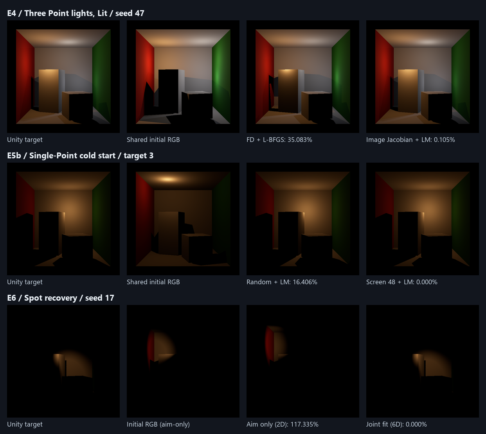

# Unity 原生 RGB · E4–E6 实验

**Image Jacobian + LM 改善了定色 Point 灯的恢复，单灯冷启动无需 GT 灯位，固定类型的 Spot 已接入插件。** 三灯多起点策略没有提高通过率；风格材质和 Spot 的困难起点仍会把局部优化带到错误解。

[逐次试验 CSV](trials.csv) · [逐查询日志、目标/初始/最佳灯具与相机参数](query-data.zip) · [插件使用说明](../../Light/Assets/LightingMvp/README.md) · [E0–E3 基线](../blackbox/README.md)



图中采用固定显示映射，误差来自原始浮点 RGB。底图 Spot 两组共享目标及初始方向，但联合组另外扰动了位置和强度。图中 `0.000%` 表示四舍五入。

## E4 · 同预算下，像素级响应是否更有用？

标量 FD 将像素变化压成一个 loss；LM 对归一化 RGB 残差做有限差分，用 `JᵀJ` 建模参数耦合。每次 Jacobian 批次用 `2D` 次原生渲染，按投影后的实际位移预测下降，再用真实渲染决定是否接受试步。两法使用同一差分 pilot 和边界策略，逐 seed 配对同一目标、起点及预算。每次试验判定：**256² 平方误差下降 ≥90%，且 256² NRMSE ≤5%**；每组至少 4/5。512² 是同一相机的高分辨率复拍，单独报告。

| 组别（预算） | 通过 FD → LM | 256² 中位 / 最差 NRMSE，FD → LM | 512² 中位 / 最差 NRMSE，FD → LM | 中位训练渲染 | 中位训练耗时 |
|---|---:|---:|---:|---:|---:|
| 单 Point Lit 4D（500） | 4/5 → **5/5** | 0.204% / 42.813% → 0.0014% / 0.0133% | 0.137% / 43.478% → 0.013% / 0.068% | 227 → 132 | 0.70 → 0.50 s |
| 三 Point Lit 12D（2,000） | 3/5 → **4/5** | 0.200% / 34.563% → 0.083% / 5.620% | 0.190% / 35.083% → 0.091% / 5.616% | 1,982 → 492 | 5.47 → 2.52 s |
| 三 Point 受控 Stylized 12D（2,000） | 2/5 → **3/5** | 8.775% / 34.825% → 0.349% / 26.549% | 8.916% / 34.808% → 0.480% / 29.487% | 1,993 → 1,965 | 5.76 → 9.30 s |

- **困难起点有实质改善。** Lit 的 seed 47：单灯 43.48% → 0.013%，三灯 35.08% → 0.105%。三灯 seed 109 仍约 5.62%。风格组 seed 73 从 14.42% 降到 0.48%，但 seed 109 从 8.92% 升到 18.39%，seed 47 仍有 29.49%。风格组渲染数没有明显下降，训练耗时反而上涨。
- **决策：** LM 以 12/15（对照 9/15）并改善总体尾部，成为 E5/E6 局部求解器，也是这类定色 Lit 任务的首选。通用插件保留 L-BFGS 默认和可选 LM；本轮没有做全色或自定义游戏材质的 LM 同预算对照。
- **历史核对：** 15 个 FD 对照的初始 loss 和预算均与 `0976bb8` 一致，14 个最终误差一致。风格 seed 73 在第 506 个查询首次出现约 `1.3e-10` 的 loss 差异，最终 512² 为历史 14.745%、本次 14.418%，均不过线。表格使用本次配对对照。

## E5 · 初始化能否避开坏起点？

**E5a / 三灯。** Lit seed 47 的 GT 在边界内，GT 和原始起点的灯位均不在挡块内部。分别将三盏灯强度减半，相对初始帧的 RGB 响应为 **33.10%、18.72%、11.48%**；起点 12 个像素 Jacobian 列范数全部非零（最小 0.658）。这排除了 GT 超界、起点灯具无响应和某个坐标完全零斜率，未识别失效的唯一原因。

两组均为 2,000 次上限。多起点保留原起点，筛 48 个不读取 GT 灯位的三灯配置；原起点和最好的两个候选各分配最多 300 次，再用剩余预算细化当时评估的最好状态。筛选的 49 次计入训练。

| 组别（同一 GT） | 单起点 → 多起点通过 | 512² 中位 / 最差 NRMSE | 中位训练渲染 | 中位训练耗时 |
|---|---:|---:|---:|---:|
| 原 5 起点 | 4/5 → 4/5 | 0.091% / 5.616% → 0.018% / 5.605% | 492 → 1,088 | 2.02 → 4.97 s |
| 另 5 个留出起点 | 3/5 → 3/5 | 0.084% / 16.893% → 0.024% / 15.506% | 809 → 1,279 | 4.20 → 6.12 s |

留出 seed 131 从 16.89% 降到 0.018%，211 从 0.080% 升到 5.605%，157 仍约 15.5%。**不把这个固定分配的策略设为默认**：它能探索不同解，但会挤占原起点的细化预算，通过率未增。

**E5b / 单灯真冷启动。** 五个不同 GT 位置及强度；候选生成只知道场景自由空间、固定灯色和预设光强范围。随机版和筛选版共用随机起点；筛选版追加 48 个归一化空间分层位置，强度固定在公开对数范围的中点，用实际 RGB 排序。两版均用 LM、最多 500 次。随机版 **4/5**，筛选版 **5/5**；512² 最差从 **16.41% 降到 0.085%**。GT3 从 16.41% 降到约 `0.00001%`。其余四个目标原本就通过；中位训练 **161 → 171 次，0.63 → 0.64 s**。**下一轮值得做固定少灯、同预算的候选初始化对照**，再测原生 RGB 对强度的近似线性，决定是否做 OLAT 字典。

## E6 · Spot 能否复用同一个后端？

Spot 新增单位球面上的两个切向方向坐标；内外锥角、Range、颜色固定。同参数重复 loss 为 0；位置、强度、方向、阴影开关和边界方向均产生可测变化。把光束从 Cornell 敞口朝外打，RGB 能量为 0，强度减半也无响应。**无照明信号时应先重定向或搜索方向，缩小差分步长不会恢复信号。**

| 任务 | 通过 | 512² 最差 NRMSE | 中位训练渲染 / 每次上限 |
|---|---:|---:|---:|
| 单 Spot 只调方向，2D | 2/3 | 117.335% | 82 / 1,000 |
| 单 Spot 联合调位置、强度、方向，6D | 3/3 | 0.00373% | 215 / 1,000 |
| 固定 Spot + Point，10D | 1/1 | 0.00137% | 477 / 2,000 |

方向组 seed 17 的方向角差从 49.8° 升到 63.7°，停在错误光斑；联合组从相同初始方向但不同位置/强度成功恢复。这验证了联合拟合的可行性，并非增加自由度必然提高成功率的消融。**插件支持现有 Point + Spot 固定灯阵；暂不进入未知灯数、类型推断或 Spot 冷启动。**

## 插件回归

插件使用场景相机自身的 URP 渲染；irradiance 仅作 Debug。首次混合灯双相机测试中，第一帧与下一帧相差 0.717% NRMSE，之后稳定。插件现在为每台相机记入一次预热，再比较两次同参数捕获；未放宽重复性阈值。三组回归均通过取消/错误恢复、全灯及单灯回放、Apply/Undo 和计数检查。

| 场景 | 方法 / 灯阵 | NRMSE 初始 → 复拍 | 训练渲染 | 配置 |
|---|---|---:|---:|---|
| [Cornell 双相机混合](cornell_mixed_lm.json) | LM / Point + Spot | 122.19% → **0.792%** | 508 | 原 HighFidelity Forward，保留 renderer features |
| [Cornell 原工作流](cornell.json) | FD / 三 Point 全色 | 91.19% → 18.23% | 1,054 | 工程回归，非研究组别验收 |
| [Mar7thRoom](mar7throom.json) | FD / 两 Point | 11.81% → **0.390%** | 536 | 原 StarRail 自定义 Deferred；测试临时显式关闭 TAA |

## 复现与记账

Unity 2022.3.62f3c1 / URP 14.0.12 / D3D11 / GTX 1060 6 GB。主实验用 Cornell 固定相机、材质组别和临时受控 URP Forward；目标、训练和验证用同一管线，两个分辨率均先检查重复性。没有外部渲染器或图像代理参与。总计 **67 次优化，57,732 次相机渲染**：训练 57,406（含筛选、差分和试步），复拍 201，共享 GT/预热/重复/坐标往返 84，诊断 41。12 个实验阶段和两个诊断的记录耗时合计约 271 秒，不含 Unity 启动。CSV 分开记录每次训练、复拍和试验总耗时；共享耗时见分阶段 JSON，不乘以试验数。

在包含本地场景资产的项目副本上用 GPU batch mode（不要用 `-nographics`）。依次对 `e4`、`e5`、`e6` 启动 Unity，等待前一项退出，三项使用同一个新输出目录。以下是传给 Unity 的参数模板：

```text
-batchmode -projectPath <Unity项目目录> -executeMethod LightingMvp.Editor.NativeRecoveryExperiment.BatchRun -bbCase <e4|e5|e6> -bbOutput <输出目录> -logFile <该阶段的日志路径>
```

从仓库根目录运行 `python mvp/blackbox_next_report.py <输出目录> --baseline docs/blackbox/trials.csv`。每组输出共享与逐查询账本、GT/初始/最佳参数和 PNG/EXR 复拍。上方 ZIP 保留 CSV/JSON；解压后可加 `--logs-only` 审核预算、配对、实际最佳查询和复拍记录。完整原生 EXR 留在本地运行目录。
