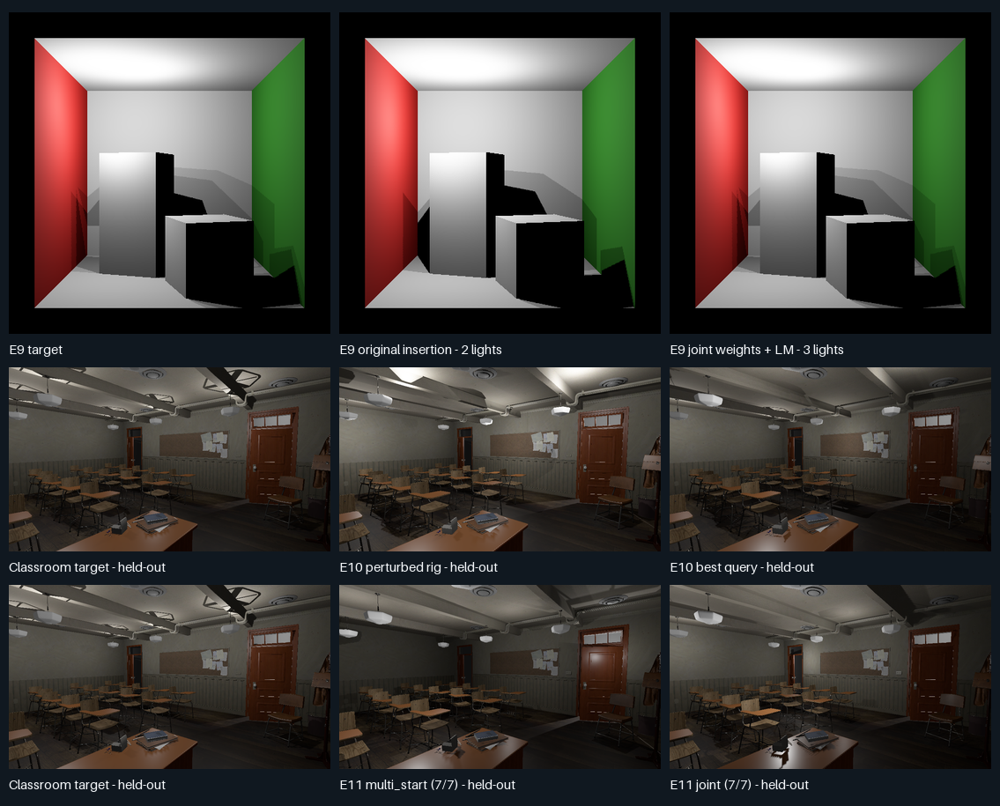

# Unity 原生 RGB 黑盒优化 · E9–E12

## E9：联合分配强度修复了四次三灯结构失败

E8 原始筛选固定已有灯强度，只允许单独加入后立即降损的候选。E9 在每个候选位置同时重算已有灯和新灯的强度，再对前三名进行真实 Unity 拍摄。三组使用相同的 Cornell Lit、搜索范围、候选种子和 2,000 次训练相机渲染上限。每次达标要求 **3 盏有效灯、训练 NRMSE ≤5%、相对空阵平方误差下降 ≥90%**。

| Cornell 主试验（每组 9 次） | 达标 | 结构失败 | 训练 NRMSE 中位 / 最差 | 512² 留出 NRMSE 中位 / 最差 | 首次达标查询中位（仅成功例） | 总训练查询中位 |
|---|---:|---:|---:|---:|---:|---:|
| A · 原始逐灯插入 + LM | 5/9 | 4 | 0.0477% / 15.2331% | 0.0611% / 14.7280% | 311 | 944 |
| B · 联合强度筛选 + LM | 9/9 | 0 | 0.0010% / 0.0102% | 0.0025% / 0.0339% | 317 | 1,200 |
| C · B + 失败时 Swap | 9/9 | 0 | 0.0010% / 0.0102% | 0.0025% / 0.0339% | 317 | 1,200 |

- **固定同一个两灯阵列也能分离强度分配的作用。** 冻结 A 的四个失败前缀、共用原来的 64 个位置。A 在四例均无正预测候选，B 在四例均测到真实降损，不需要先移动旧灯。`clustered / 181` 在同一前缀中，B 将第三灯插入前后的真实平方误差从 `0.02320475` 降到 `0.01499259`；此时三盏灯的合法权重约为 `1.977 / 1.463 / 0.133`。主试验中 B 从自己的前缀继续 LM，最终以三灯达到 **0.0061%** 训练 NRMSE，A 以两灯停在 **15.2331%**。
- **覆盖与权重分配是不同瓶颈。** 4 个失败前缀的 256 候选配对诊断保持同一个 2,000 查询上限。A 补齐四个阵列，其中三例达标，但 `clustered / 181` 仍为 **7.3440%**；B/C 在原来的 64 候选已四例达标。
- **本批没有触发 Swap。** 联合筛选先解决了插入失败，B/C 的已验证训练查询与最终结果完全相同。13 对含诊断试验中没有 Swap 介入，因此没有测得替换本身的增益。

E9 使用 256² 训练和 512² 复拍，沿用 E8 的训练视角，固定一个不同的留出姿态。三套目标为复用的 `clustered` 与预先固定的 `tight_pair`、`weak_neighbor`，配对种子 `131 / 157 / 181`。主试验和 256 候选诊断共 39 次试验、48,301 次训练渲染；固定前缀诊断另计 546 次实验渲染和 8 次参考渲染。强度先在 `[0,9]` 上求解；若任一强度低于 `0.055`（包括零），固定灯数试验改在 `[0.055,9]` 重求并重新评分。只有合法阵列会进入 Unity 验证。

## 公开场景：Classroom 的七盏原有点光源

使用 Christophe Seux 的 [Blender 官方 Classroom 样例](https://download.blender.org/demo/test/classroom.zip)：六盏课堂灯和一盏走廊灯，**保留全部七盏作者原有 Point 的位置和数量**。导出使用几何、UV 和贴图；Unity 用标准 URP Lit 对材质做映射。源文件的 Sun 和两个 Area 不进入这项固定白色 Point 试验；强度换算为 `min(6, 1.1 × 源数值)`，统一 Range 5.25 m。该基准测试的是资产移植后的 Unity 照明响应，不比较 Cycles 与 Unity 的图像。

Unity 移植相机使用 `7:4` 画幅，训练 `448 × 256`、复拍 `896 × 512`；训练候选包括两处课堂视角与一处走廊视角，另有课堂与走廊各一个留出视角。固定环境设定、显示映射和实时硬阴影，无后处理、自动曝光、TAA 或动态 GI。实验环境：Unity 2022.3.62f3c1 / URP 14.0.12 / D3D11 / NVIDIA GTX 1060 6 GB。Classroom 使用 URP Forward+；源 URP 资产的 Forward 每物体配置为 8，Forward+ 不使用该每物体上限。阴影 atlas `2048²`，配置的每面 tile `256²`，7 盏点光请求至多 42 面（容量 64）；留出/训练相机、灯位域和强度映射见[原生查询与配置 ZIP](query-data.zip)中的 `e10/scene.json`。

## E10：原生渲染体检

- 同参数原生复拍的五个视角 NRMSE 均为 0。单灯沿合法方向移动 `0.108 m`，主视角变化约 38.15% NRMSE；把它的强度从 `1.1` 减到 `0.55`，主视角变化约 22.63%。逐灯在完整阵列中关闭后，七盏灯在三个训练候选视角中的至少一个都有可辨别的贡献。走廊灯在走廊视角最强，实际关闭使该视角变化约 99.98% NRMSE。
- 单视角和三视角均通过 E10 的 OLAT 体检。强度缩放最大相对 L2 约 `8.15×10⁻⁸` / `6.45×10⁻⁸`；1/5/7 灯叠加最大约 **0.0239% / 0.0263%**。已有 1/5/6 灯上下文的六组秩相关均为 **1.00**，预测 Top-3 均含实际最优位置。该结果来自当前场景和 Forward+ / atlas 配置。

### 已知灯阵恢复：大扰动下没有达标

每盏灯的位置扰动 `0.50–0.68 m`；强度乘 `0.48` 或 `1.85`，再限到共同的 `[0.055, 9]`。三组配对起点，单/三视角各用现有 Full Image Jacobian LM，每次上限 6,000 次相机渲染。

| 训练视角 | 达标 | 训练 NRMSE 中位 / 最差 | 同训练相机复拍中位 / 最差 | 两留出视角中位 / 最差 | 总训练查询中位 | 耗时中位 |
|---|---:|---:|---:|---:|---:|---:|
| 1 | 0/3 | 60.50% / 65.53% | 63.66% / 68.08% | 81.28% / 1440.43% | 5,258 | 61.45 s |
| 3 | 0/3 | 56.72% / 61.29% | 58.85% / 61.85% | 68.93% / 69.13% | 5,889 | 65.41 s |

三视角降低了留出尾部误差，但没有把训练误差带到 5% 门槛。对 `131 / 3v`，走廊训练和留出误差分别为 **0.10% / 0.28%**，而两处课堂训练视角为 **62.69% / 68.27%**、课堂留出为 **97.48%**。因此，已知点光数、线性强度和可重复渲染并不意味着能从大范围灯位扰动恢复。

查看 `131 / 3v` 主相机的原生 EXR：起点最亮通道为 `600.93`，GT 为 `7.72`；误差最大的约 1% 像素贡献了 **99.86%** 的起点平方误差。这解释了固定显示映射下画面变化与线性 HDR NRMSE 尺度不同。[空间误差数据](hdr-spatial-stats.json)取自 896×512 EXR。

七灯为 28 个坐标，单 / 三视角的完整中心差分理论成本为 56 / 168 次相机渲染（不含试步）。实际大扰动试验合计 **33,923** 次训练拍摄。单 / 三视角 LM 图像缓冲分别约 40.7 / 122.1 MiB；对应构建 `JᵀJ` 的耗时中位数为 18.97 / 21.81 s，线性求解耗时中位数均低于 0.01 s。渲染提交与读回单列，读回计时包含 GPU 同步等待；不是纯 CPU 计时。每视角误差、差分与残差开销见逐试验数据。

### 已知灯阵恢复：近起点改善终点，但仍未达标

独立诊断使用同样的三个配对种子和 6,000 次上限，位置偏移改为 `0.09–0.15 m`，初始偏移路径通过 Collider 余量检查，强度乘 `0.65` 或 `1.48`。几何距离更近并不等于起始图像更近：两组的初始训练 NRMSE 中位分别为 **1035.12% / 1073.56%**。

| 训练视角 | 达标 | 训练 NRMSE 中位 / 最差 | 同训练相机复拍中位 / 最差 | 两留出视角中位 / 最差 | 总训练查询中位 | 耗时中位 |
|---|---:|---:|---:|---:|---:|---:|
| 1 | 0/3 | 41.65% / 42.00% | 43.98% / 63.46% | 55.54% / 74.49% | 5,973 | 69.74 s |
| 3 | 0/3 | 32.75% / 34.71% | 37.25% / 48.16% | 57.32% / 68.38% | 5,919 | 68.27 s |

近起点对照相对于大扰动降低了训练终点误差；12 次 E10 已知灯阵恢复均未达到 5%，因此无首次达标查询。近起点对照共用 35,685 次训练拍摄；同一 Editor 进程在这组运行中的系统物理内存高水位约 **2.18 GiB**（`e10_near/editor-memory.csv`），含 Editor、资产、渲染和求解器。逐试验中由 Mono 返回的 `0` 表示该内存计数不可用。

## E11：单种子七灯冷启动验证

按 E10 的误差对比使用三视角和已过门槛的 OLAT。求解端只读取目标图和七灯数量；起点及 128 个候选位置独立于 GT。三组均使用 6,000 次相机渲染上限，种子 `131`。

| 冷启动方法 | 有效灯数 | 训练 NRMSE | 512 短边同视角 | 两留出视角 NRMSE | 训练查询 |
|---|---:|---:|---:|---:|---:|
| Multi-start + LM | 7 | 80.66% | 81.63% | 116.55% | 5,901 |
| 原始逐灯插入 + LM | 7 | 54.44% | 55.38% | 69.20% | 5,946 |
| 联合强度逐灯插入 + LM | 7 | 55.78% | 57.67% | 69.19% | 5,979 |

两种逐灯方法都补齐了七盏，其中联合强度法未优于原始逐灯法的训练误差。三组均未通过 5% 门槛，均由预算停止。原始逐灯法的走廊训练误差约 **0.03%**，两处课堂训练误差仍为 **69.31% / 63.93%**。这次冷启动生成了指定灯数，但没有恢复目标照明。单种子三组共 **17,826** 次训练渲染。

完整 E11 的门槛是已知灯阵至少 2/3 达标且留出不明显退化。两档起点的 E10 都未达到门槛，因此 E11 仅有上述单种子数据；没有运行完整冷启动矩阵，也未启动 E12 未知灯数实验。

## 实现回归与复现

- 交互插件的双相机 Point + Spot 批处理回归（`LightingMvp.Editor.BlackBoxLightingSmoke.BatchMixedLm`）使用 508 次训练拍摄，NRMSE 从 **122.19%** 降到复拍的 **0.79%**。插件仍直接比较原生 RGB，irradiance 只用于调试。
- 最终源码重跑 `e9-smoke`，`clustered / 181` 的六个结果与主矩阵及扩池诊断一致；Windows 实测该 Editor 进程的工作集峰值为 **1.94 GiB**。用同一版源码验证完整 `e11` 入口时，实际 E10 门槛拒绝了该次运行，未生成冷启动试验结果。

基线源码为 `blackbox@1831727`；本轮更新增加了以下批处理入口。参见 [试验表](trials.csv)、[同预算检查点](query-checkpoints.csv)、[汇总](summary.json) 和 [原生查询、配置及逐次试验 ZIP](query-data.zip)。图像取自 Unity 复拍，显示映射固定。



1. 在本地 Unity 项目副本准备 Cornell 场景与 HighFidelity URP 参考资产。E9 从 E7 读取 Cornell Lit 的门槛，用同一个新输出目录依次运行 `e7`、`e9`、`e9-probe`。`e9-smoke` 独立输出，`-bbE9Budget 4000` 适用于整个配对矩阵。
2. 获取上方的 Classroom ZIP（SHA-256：`0f0ecc58d45f12b2f4272a53e2d8e69135518e16e956b118f10c20d8dcfdf5e6`），解压时保留 `.blend` 和其并列的链接资产。在 Blender 5.2 命令行导出。源资产不随结果打包。

```text
blender -b <Classroom目录>/classroom.blend --python-exit-code 1 --python mvp/export_classroom_scale.py -- <Unity项目目录>/Assets/ClassroomScale
```

```text
Unity -batchmode -force-d3d11 -projectPath <Unity项目目录> -executeMethod LightingMvp.Editor.NativeRecoveryExperiment.BatchRun -bbCase <阶段> -bbOutput <共同输出目录> -logFile <日志文件>
```

Classroom 的完整试验使用 `e10` 做配对恢复；`e10-smoke` 是单种子配置检查，`e10-near` 是同预算的近起点对照。`e11-smoke` 读取同一目录下已完成的 E10 选择；`-bbScaleGate e10_near` 切换到近起点门槛。完整 `e11` 读取同一配置下的 E10 与同预算 smoke。七灯配对的 `-bbScaleBudget` 为 6000；E11 的 `-bbScalePool` 为 128。Blender 只用于静态资产转换；训练只使用 Unity 原生线性 HDR RGB。

```text
python mvp/blackbox_scale_report.py <共同输出目录> --out <报告目录> --archive --plot
```

`--plot` 使用 Pillow。ZIP 解压后可不带图片选项复查逐次查询、最佳真实阵列、复拍误差、固定候选配对和达标节点。多视角目标为 `sqrt(mean_v(L2² / (targetEnergy_v+ε)))`；每次相机拍摄计一次，参考目标及验证复拍单列。

空间误差统计从 E10 输出的原生 EXR 复算。此命令只读取 EXR，不渲染：

```text
blender -b --python-exit-code 1 --python mvp/blackbox_scale_exr_stats.py -- hdr-spatial-stats.json <输出目录>/e10/target_view0.exr <输出目录>/e10/131_known_3v/initial_view0.exr <输出目录>/e10/131_known_3v/best_view0.exr
```
