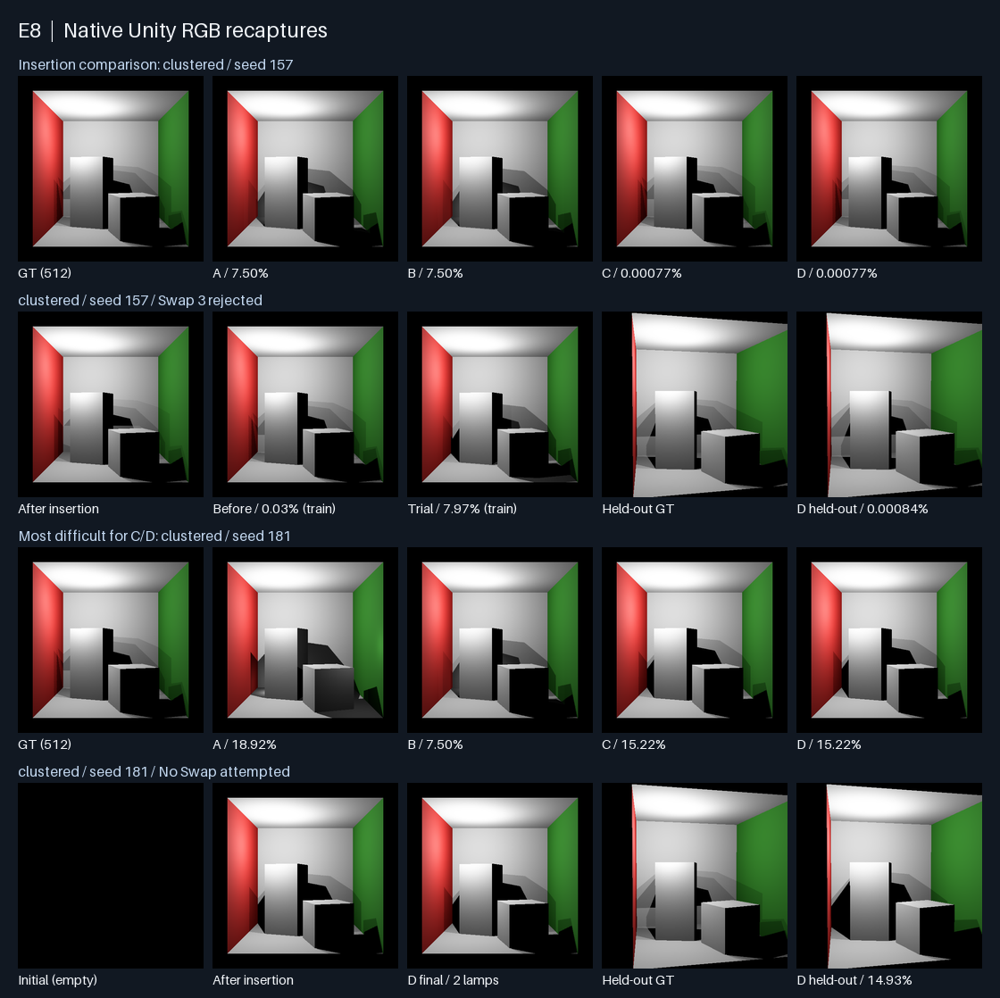

# Unity 原生 RGB 黑盒优化 · E7–E8

## E7 结果：逐灯响应满足缓存门槛

| 材质 | 强度相对 L2：中位 / 最差 | 叠加相对 L2：中位 / 最差 | 排序 ρ（已有 0 / 1 / 2 灯） | 相机渲染 |
|---|---:|---:|---:|---:|
| Cornell Lit | 0% / 0% | 0.0000784% / 0.0004702% | 1 / 1 / 1 | 287 |
| Cornell Stylized | 0.00000557% / 0.00000737% | 0.0001022% / 0.0003796% | 1 / 1 / 1 | 287 |

没有近零样本；六组排序的预测首位均为真实首位。Lit 达到门槛后，E8 在每次试验中缓存 **64 次逐灯原生渲染**的结果，在三个插入步骤和 Swap 之间复用。非 2 的幂次的强度档也参加了排序交叉检查。Stylized 的角度分段对灯位仍非光滑，但本例着色器在固定位置下逐灯累加，因此位置不光滑与强度近线性可以同时成立。该判定覆盖本轮关闭后处理和时序效果的两种 Cornell 材质配置。参见 [E7 数据](e7.json)。

## E8 结果：逐灯插入有效，Swap 未改善尾部

60 次配对试验（5 套 GT × 3 个种子 × 4 个方法）。表内误差均为 NRMSE；“首次达标”只统计成功试验，“总查询”列为每次试验的中位数，单次上限均为 2,000 次相机渲染。

| 方法 | 256² 通过 | 256² 中位 / 最差 | 512² 同视角中位 / 最差 | 512² 留出视角中位 / 最差 | 首次达标查询 | 总查询 | 训练耗时中位 |
|---|---:|---:|---:|---:|---:|---:|---:|
| A · 随机三灯 + LM | 9/15 | 0.0517% / 29.93% | 0.0682% / 29.95% | 0.1664% / 64.72% | 495 | 832 | 4.50 s |
| B · Multi-start + LM | 12/15 | 0.0206% / 7.35% | 0.0385% / **7.50%** | 0.0369% / **7.50%** | 728.5 | 1,324 | 6.93 s |
| C · 逐灯插入 + LM | **14/15** | **0.0005%** / 15.23% | **0.0006%** / 15.22% | **0.0008%** / 14.93% | 347.5 | 1,027 | 4.85 s |
| D · C + Swap | **14/15** | **0.0005%** / 15.23% | **0.0006%** / 15.22% | **0.0008%** / 14.93% | 347.5 | 1,282 | 6.56 s |

| GT 题型 | A | B | C | D |
|---|---:|---:|---:|---:|
| 分散 `spread` | 3/3 | 3/3 | 3/3 | 3/3 |
| 集中 `clustered` | 0/3 | 0/3 | 2/3 | 2/3 |
| 强弱不均 `unbalanced` | 2/3 | 3/3 | 3/3 | 3/3 |
| 遮挡 `occluded` | 2/3 | 3/3 | 3/3 | 3/3 |
| 边界 `boundary` | 2/3 | 3/3 | 3/3 | 3/3 |

- **C 的增益来自冷启动。** C 与 B 共同成功的 12 对试验中，C 有 10 对更早达标，配对中位少 406.5 次查询；额外恢复了集中场景的两个种子。例如 `clustered / 157` 的同视角 512² NRMSE 由 B 的 7.50% 降到 C 的 0.0008%。但 B 的最差误差更小，C 的通过率优势不等于尾部优势。
- **最难例是插入本身失败。** `clustered / 181` 在两灯后仍有约 15.23% 训练 NRMSE，但搜索 64 个采样位置未找到预测能降损的候选，因此两组都停在两灯。未形成有效三灯阵列，D 按规则没有触发 Swap。这个试验区分了“当前阵列中的单个候选能否立即降损”和“允许现有灯具重新分配后能否得到更好的阵列”。
- **D 的 39 次尝试均回滚。** 13 个已生成完整阵列的试验触发 Swap，每次尝试消耗 84–87 次，共 3,346 次。候选初始替换距离中位 0.279 m，联合 LM 后相对被移除灯的位置差中位仅 0.00144 m；一些替换回到了原来附近，较远的试步也未得到更低的训练误差。15 对最终 Rig 和三种 RGB 误差均与 C 完全相同。C/D 形成的完整阵列均已达标；两组在同一个试验中插入第三盏灯失败，早于 Swap 的介入阶段。

[逐 GT / 种子结果](trials.csv) · [逐查询账本、参数、初始/最终 Rig 和 Swap 记录](query-data.zip)



测试环境：Unity 2022.3.62f3c1 / URP 14.0.12 / D3D11 / GTX 1060 6 GB。E7 用 574 次原生渲染；E8 主试验用 71,892 次训练渲染、45 次共享预热/GT/重复检查、348 次复拍，场景内总耗时约 425 秒。离线核验覆盖 60 次试验的每条查询和最佳 Rig 复拍；另从场景 Collider 复核了 200,945 个已提交的灯位，未发现落入排除体积。双相机 Point + Spot 插件回归也通过：原生 RGB NRMSE 从 122.19% 降至 0.792%，现有工作流不变。

## 问题与实验设计

E7 测试 Unity 原生线性 HDR RGB 在强度缩放和灯具叠加下能否近似线性。E8 在不知道 GT 灯位的条件下，比较残差驱动的逐灯插入能否比随机或 Multi-start 更稳定地生成三灯 Rig；再单独检查 Swap 能否修正较早选错的灯位。

### E7：用实测决定候选筛选模型

- Cornell Lit 与现有 Stylized Point Response 材质使用相同相机、URP Forward、开启阴影、关闭时序效果。以关闭三个实验灯槽的 RGB 为基准，保持其余场景设置不变。
- 两组位置（三盏高位与三盏低位/遮挡）各测 `0.25 / 0.5 / 1 / 2` 倍强度，再测每组的三个双灯组合和一个三灯组合。相对 L2 的分母是真实增量 RGB 的 L2；`≤ 1e-6` 的增量单独计数。
- 用另一批 24 个候选位置，在已有 0、1、2 盏灯的三个残差任务中，比较 OLAT 预测与实际 RGB 渲染的最佳增益排序。两侧使用相同的强度档 `.35 / 1 / 3`，因此比较的是响应近似，而不是强度网格的覆盖差异。
- 强度线性与多灯叠加均须满足中位误差 ≤2%、最差 ≤5%；三个排序任务均需 Spearman ρ ≥0.90、预测前三中真正最优增益相对损失 ≤1%。E8 只读取 Lit 的判定。

### E8：固定三灯冷启动

| 组 | 起点与优化 |
|---|---|
| A | 场景自由空间均匀随机抽取三灯；Image Jacobian LM |
| B | 与 A 共用第一套随机 Rig；另用 48 套完整 LHS Rig 筛选，共用起点与最好的两个新起点各获最多 300 次短 LM，再从实际最优查询继续 LM |
| C | 从空阵逐灯插入；每插一灯以最多 120 次做当前灯阵的联合 LM；到三灯后继续 LM |
| D | 与 C 从空阵起共享相同的确定性查询前缀；三灯联合 LM 实际停滞后再试单灯移除与替换，最多使用总训练预算的 25%；之后用剩余配额继续 LM |

- 固定五套公开 GT 题型覆盖分散、集中、强弱不均、遮挡与空间边界，每题用 `131 / 157 / 181` 三个配对种子。优化端只得到目标图；公开的参数域、候选池和停止规则都不访问 GT 灯位。三盏灯均为白色 Point Light，Range 4 m，只调 `(x, y, z, log intensity)`。
- 位置边界 `x,z ∈ [-0.91, 0.91] m`、`y ∈ [0.15, 1.94] m`，避开两只旋转方箱各自扩张 4.5 cm 后的体积；强度 `[0.055, 9]`。结合原有 LHS 和几何拒绝筛选（不足时补抽），每个 seed 生成 64 个 C/D 共用候选位置。插入或替换之后，LM 可以离开采样点。非法差分用可行侧或缩小步长；非法试步先缩步，不渲染也不产生惩罚残差。
- 若 E7 通过，则 64 张逐灯原生响应按 seed 在试验内缓存，投影到当前残差求合法强度；否则把 `.35 / 1 / 3` 三档实际加入当前灯阵，以全部 192 个实际 RGB 查询排序。OLAT 短名单仅纳入预测能降损的候选；每次最多在场景中重新渲染前三名。没有正收益候选或复拍未测到有效降损时记为结构失败，不强行补灯。插入阶段最多 1,024 次，包含本轮空阵与候选查询。
- C/D 在最多占总预算 75% 的共同阶段之后分流。D 仅在共同 LM 以实际局部停滞停止时尝试 Swap，逐个移除原灯并在全局候选池排名；对最优替代做短程三灯联合 LM，严格优于当前已验证的完整阵列才接受。达到查询上限或近零残差不触发 Swap。
- 主试验每次最多 2,000 次 256² 训练渲染；报告中的结果均来自这一预算。用 512² 同视角和一个移位留出视角重新渲染最佳状态。通过要求 256² NRMSE ≤5% 且相对空灯阵平方误差下降 ≥90%；空灯阵已达 5% 的独立标记。NRMSE 是线性 RGB 全图 L2 误差/目标 RGB 的 L2；预热、GT、复拍不占训练预算。

## 复现与核验

使用 Unity 2022.3 / URP 14，带本地 Cornell 场景和 HighFidelity 管线资源的项目副本。不要加 `-nographics`；依次运行 `e7`、`e8`，使用同一个新的输出目录。

```text
-batchmode -projectPath <Unity项目目录> -executeMethod LightingMvp.Editor.NativeRecoveryExperiment.BatchRun -bbCase <e7|e8> -bbOutput <输出目录> -logFile <日志路径>
```

`e8-smoke` 只跑第一套 GT、一个种子的四种方法并独立输出；`-bbE8Budget 4000` 运行统一追加预算对照，输出在不同子目录。实验不需要外部渲染器。交互式插件仍使用场景本身的原生 RGB，irradiance 仅用于调试；逐灯生成和 Swap 在本轮是 Cornell 研究入口，不改变插件默认算法。

```text
python mvp/blackbox_structure_report.py <输出目录> --out <报告目录> --plots --archive
```

核验脚本从账本重算线性门槛、C/D 共同前缀、实际训练次数、首次达标查询及最优 Rig 复拍。`--plots` 需要 Pillow ≥10.1；用解压后的 CSV/JSON 复核时可省略 `--plots` 与 `--archive`。批处理目录保留原生 PNG/EXR、GT/初始/生成/最佳 Rig，以及每次 Swap 的前后候选图。
