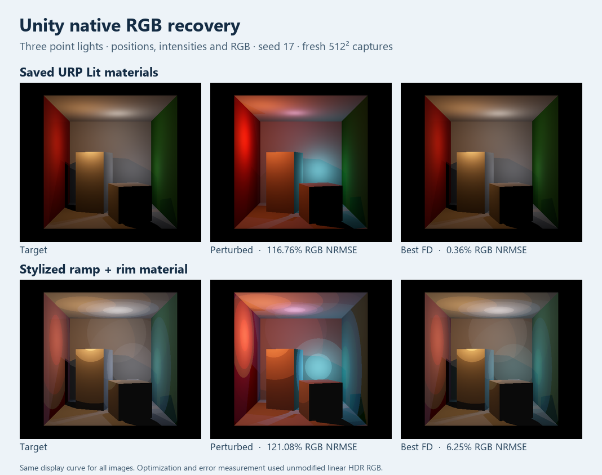
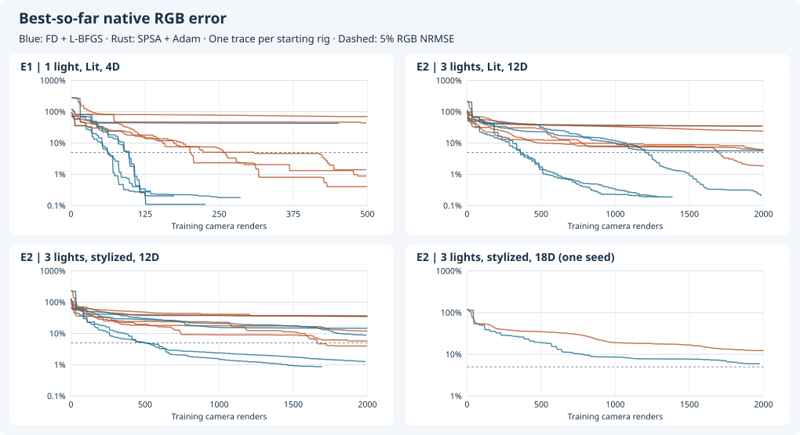
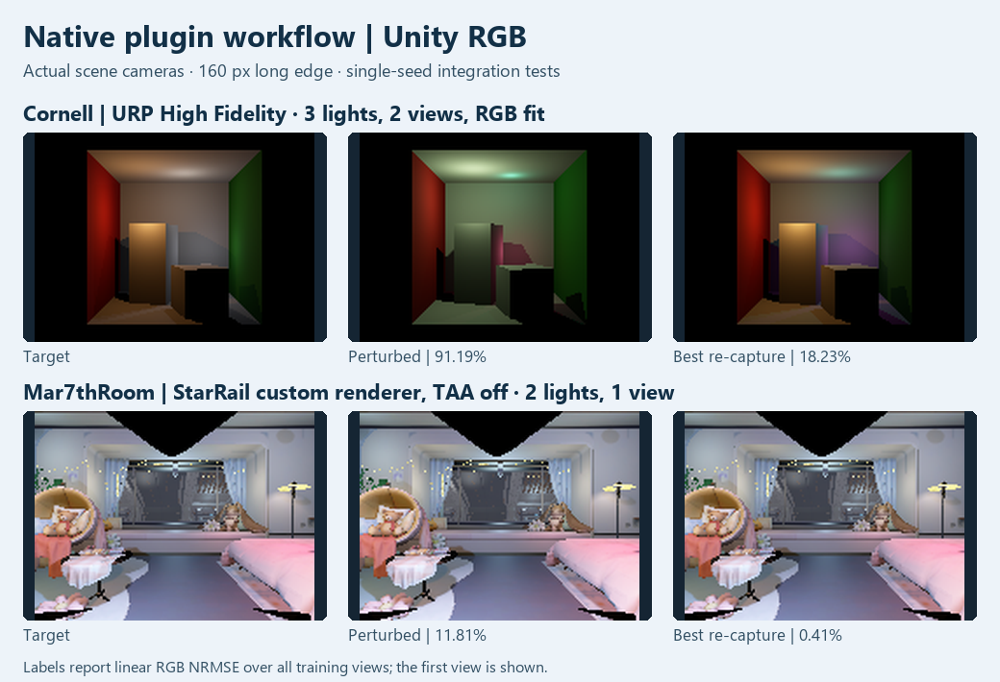

# Unity 黑盒灯光恢复：实验与结论

**最终 RGB 可以直接驱动 Unity 灯具恢复；目前主要难点是收敛稳定性，而不是缺少可微的 Shader。** 最强的定性证据来自三灯全色实验：初始画面明显错位、偏色，FD 能同时找回原生阴影、光斑和风格材质的分段色带。稳定性证据更弱：只有单灯 Lit 基线达到预设的五起点验收门槛。

## 逐项实验

| 实验 | 为什么做 | 观察与结论 |
|---|---|---|
| **E0 · 渲染端体检** | 先确认有限差分看到的是点灯响应，不是回读、时序或颜色截断。 | Lit 和风格材质在各自的固定会话中，同参数重复 `J=0`。最弱的受控扰动 `J` 仍有 **0.00955 / 0.01046**；高亮峰值 **39.92 / 63.79**，确认浮点 RGB 保留了 1 以上的能量。说明 Cornell 基线的查询有稳定信号，也给真实场景提供了一个必要的体检。 |
| **E1 · 单灯 Lit，4D** | 先隔离灯位和强度，建立带遮挡的低维基线。 | 500 次上限下，FD **4/5**，中位 **0.20%** NRMSE；SPSA **3/5，1.40%**。FD 中位用了 **227 次 / 0.71 s**，SPSA **498 次 / 1.38 s**。SPSA 单对探针便宜，但此处总查询没有更省。共同失败起点 seed 47 仍约 **43%**，单灯也有难以进入的吸引域。 |
| **E2 · 三灯定色，12D** | 先固定颜色，把灯光叠加和维数上涨同颜色自由度分开；再替换材质，看同一求解器能否适应非物理响应。 | Lit：FD **3/5，0.20%**；SPSA **1/5，6.06%**。风格：FD **2/5，8.77%**；SPSA **1/5，11.94%**。Lit 的 FD 中位数与 E1 一样低，但两个起点停在 **5.63% / 34.56%**，只看中位数会误判鲁棒性。风格材质改变了优化所见的响应面；本组对照没有单独识别 ramp 或 rim 的因果贡献。 |
| **E2 · 三灯全色，18D smoke** | 检查未知灯色和自定义材质能否一起恢复，并用更高分辨率排除只拟合低清画面的解释。 | seed 17 的 512² FD 复拍：Lit **116.76% → 0.36%**；风格 **121.08% → 6.25%**。SPSA 复拍为 **11.18% / 12.39%**。风格案例找回了目标的主要色带、热点和明暗结构；细小阈值边界仍有误差，且 **6.25% 未过线**。这是存在性验证，不代替五起点验收。 |
| **E3 · 留出视角，18D Lit** | 区分“拟合训练截图”与“恢复可从别处观察的 3D 灯阵”，并测量多视角成本。 | seed 17、同为 6,000 次渲染预算，FD 一/三训练视角的两留出视角复拍分别为 **0.26% / 0.34%**，实际花 **2,732 / 5,982** 次；SPSA **9.51% / 11.14%**。此起点用单视角已得到可迁移的灯阵。三视角每次评价花三渲染，固定预算下少了目标评价次数；还需用困难起点和遮挡互补视角判断多视角价值。 |
| **阴影消融** | 检查困难起点是不是只被硬阴影边界卡住。 | 同一 seed 47，关实时阴影后 E1 FD **42.81% → 42.56%**，E2 Lit 定色 **34.56% → 31.17%**，都仍未通过。优先尝试多起点、粗到细或分灯更新，而不是先改阴影模型。 |
| **ZeroGrads 对照** | 测试学习局部平滑代理是否能在相同真实渲染预算下改善停滞。 | 当前配置在 E1 / E2 Lit 定色均 **0/5**，中位 **47.83% / 45.19%**；风格全色 smoke **41.12%**。三灯定色用 **1,996 次 / 11.79 s**，FD **1,982 次 / 5.67 s**。这组配置不值得当默认；不能外推到其他采样半径、代理容量或更新策略。 |

## 怎么读这些结果

- **可行性与成功率是两件事。** URP 自己生成像素，所以材质和阴影不需要被重写或求导。但目标只约束可见外观，并不保证几何上唯一的灯阵；纯发光、不读实时点灯、互相抵消的灯具等仍可能缺乏可辨识信号。
- **优先提高困难起点的成功率。** 用相同总查询预算比较单起点 FD 与多起点/低分辨率筛选后细化，报告通过率和最差种子，而不是只看平均或中位。再把全色风格材质和真实游戏场景纳入五起点及留出视角测试。
- **量化口径：** `J` 为各视角 `Σ(R−T)² / (ΣT²+ε)` 的均值，RGB NRMSE=`sqrt(J)`；超过 100% 表示误差能量高于目标能量，不是越界。通过要求平方误差下降 ≥90% 且训练 NRMSE ≤5%，阶段门槛 ≥4/5。默认表格为 256²，标明复拍处为 512²。Cornell 用 stock URP Forward、实时阴影、固定几何和相机；关闭后期和时序项。GT 是同引擎可实现灯阵，尚未验证任意外部参考图可达。
- **查询口径：** 每实际相机渲染计一次；训练含步长试探、数值差分和线搜索；GT、预热及验证另计。合计 **69 次优化 / 108,303 次相机渲染**。硬件 D3D11 / GTX 1060，Unity 2022.3.62f3c1 / URP 14.0.12。同步回读耗时含等待 GPU，不是纯传输时间。

## 插件集成验证（独立于上述 Cornell 研究矩阵）

| 运行配置 | 原生 RGB 复拍 NRMSE | 说明 |
|---|---:|---|
| [Cornell 插件 smoke](cornell.json)：HighFidelity Forward（保留 renderer features），三灯、两相机、拟合颜色 | **91.19% → 18.23%** | 1,054 次训练相机渲染。覆盖交互工作流的调用、预算、取消/异常恢复、多灯和单灯回放、应用与 Undo；不是研究矩阵中的精度验收。 |
| [Mar7thRoom 插件 smoke](mar7throom.json)：StarRail 原 CRP 自定义渲染器，固定室内相机、两盏临时点灯，定色 | **11.81% → 0.41%** | 529 次训练相机渲染。默认配置同灯阵的两次离屏渲染未通过重复性检查；仅临时关闭 StarRail 的 TAA Volume 后通过并收敛，保留原材质、Deferred 渲染器及其他 Renderer Features。 |

Mar7thRoom 的结果支持把路线扩到真实自定义管线：可用性取决于灯具是否改变可见 RGB、渲染能否在固定状态下重复。这个 smoke 使用可实现的目标和临时灯具；默认 TAA 配置、运行态动态内容及全色多起点恢复尚未验证。测试没有改写项目场景或资产。

## 数据与复现

- [逐次试验汇总](trials.csv) · [逐查询日志、拟合参数、阶段报告和精选实图（ZIP）](query-data.zip)。训练预算、视角记账与历史最佳查询均和汇总表核对；完整本地复拍结果中，记录的最佳 `J` 与同配置复拍一致。
- 解压到任意目录，用仓库的 `python mvp/blackbox_report.py <解压目录>` 重建可浏览的 HTML 曲线报告。ZIP 保留逐查询数据，不包含场景资产或全量 EXR。
- [Unity 工作流和批处理复现](../../Light/Assets/LightingMvp/README.md)。研究中 SPSA 是基于全局 RGB loss 的随机有限差分，参考 [I3D 2024](https://ggx-research.github.io/publication/2024/04/17/publication-intel-diffrast.html)，不复现其像素级梯度策略；[ZeroGrads](https://mfischer-ucl.github.io/zerograds/) 是离线代理对照，所有实际图像同样由 Unity 生成。
