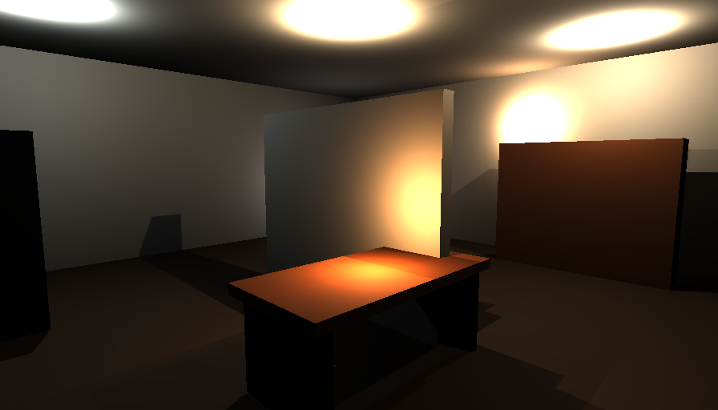

# Unity 原生多灯场景

## Classroom 的来源

E9–E16 使用的 Classroom 是 Blender 官方样例 `classroom.zip` 里的 `classroom.blend` 场景，不含任何 Unity 资产。迁移时把几何、UV 和贴图导出为 FBX，再在 Unity 里用 URP Lit 重建材质，所以它本质上是 Blender 内容在 Unity 里的重打光复现，不是 Unity 原生场景：材质响应、UV 接缝和贴图色彩都经过了一次转换。

## 现成候选核查

| 候选 | 管线 | 灯 | 许可 | 结论 |
|---|---|---|---|---|
| Unity `Graphics` 仓库 `008_AdditionalLights` | URP | 8 Point + 1 Directional，全部 Realtime | Unity Companion License | 灯数与实时性完全符合；属于 URP 测试工程，场景依赖测试框架脚本、Prefab 和工程内材质，单独拷贝需要连同依赖一起搬 |
| BricL `InteriorDesignByUnity` | URP 12.1.12 | 10 个 Light：6 Realtime Point、3 Baked Area、1 Baked Directional | 仓库无 LICENSE，家具与天空盒为第三方资源 | 视觉上是真实卧室，但 6 盏实时灯之外全部是烘焙光照，烘焙 GI 不随灯参数变化；且许可不明，不能进入公开仓库 |
| Unity HDRP `ExampleInteriorLight` | HDRP | 3 Point + 3 Spot | Unity Companion License | 管线不符，不可用于当前 URP 工程 |
| URP `Indoors` 场景模板 | URP | 4 Point | Unity Companion License | 不足 5 盏 |

没有找到同时满足 Unity 原生、URP、真实室内、5–10 盏、全部实时、许可明确这五项条件的现成资源。

## 自建原生场景

`Assets/LightingMvp/Editor/NativeRoomBuilder.cs` 用 Unity 内置 Cube 图元和 URP Lit 生成 `Assets/Scenes/UrpNativeRoom.unity`：7.8 × 3 × 7.8 m 房间、办公桌、椅子、柜体、隔断、置物架，共 18 个网格体；7 盏 Realtime Point Light 命名为 `Candidate Light 01..07`，硬阴影、关闭色温、关闭烘焙与实时 GI，环境光为 0.035 的 Flat 常量，相机为 896×512 固定机位。场景中没有贴图、自定义 Shader、后处理或方向光，材质只有 URP Lit。

| 灯 | 位置 (m) | 颜色 | 强度 | Range |
|---|---|---|---|---|
| 01 | (0, 2.82, 0) | 1.00, 0.95, 0.88 | 6.0 | 9 |
| 02 | (-2.4, 2.82, 1.8) | 1.00, 0.97, 0.93 | 4.5 | 7 |
| 03 | (2.4, 2.82, -1.6) | 0.92, 0.96, 1.00 | 4.5 | 7 |
| 04 | (0, 2.82, 2.6) | 1.00, 0.93, 0.84 | 3.2 | 6 |
| 05 | (-3.55, 2.1, 0.4) | 1.00, 0.90, 0.80 | 2.2 | 4 |
| 06 | (0.9, 1.18, 1.2) | 1.00, 0.86, 0.70 | 1.6 | 3 |
| 07 | (-2.2, 1.05, -2.6) | 0.95, 0.95, 1.00 | 2.0 | 4 |

重建与预览：

```
Unity -batchmode -nographics -quit -projectPath <项目> -executeMethod LightingMvp.Editor.NativeRoomBuilder.Build
Unity -batchmode -force-d3d11 -quit -projectPath <项目> -executeMethod LightingMvp.Editor.NativeRoomBuilder.Preview
```

场景资产不入库（`.gitignore` 排除 `Light/Assets/*`），只提交生成脚本，任何机器可复现同一份几何与灯阵。

## 验证

`UrpNativeRoom.unity` 由 Unity 2022.3.62f3c1 批处理生成并成功保存；YAML 中 7 个 `Light` 组件全部为 `m_Type: 2`（Point）、`m_Lightmapping: 4`（Realtime）。896×512 的 D3D11 原生渲染见 `urp-native-room.png`：七盏灯在桌面、隔断、柜体和墙面上形成彼此可分的亮斑与阴影，画面峰值远超中位数，具备 HDR 动态范围。


